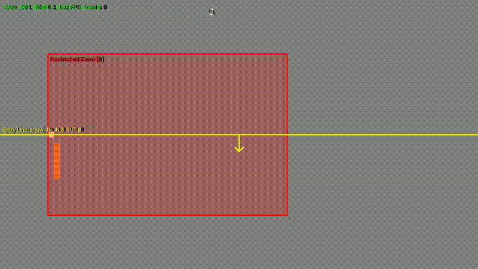

# Border AI: AI Video Intelligence Platform

Real-time video analytics for existing CCTV/IP-camera infrastructure: detection,
tracking, restricted-zone and line-crossing events, Automated Number Plate Recognition (ANPR),
PostgreSQL-backed operational watchlists, facial biometric recognition, cross-camera person appearance Re-ID,
and (in progress) behaviour rules, threat scoring, and an investigation dashboard.



---

## Current Status (Day 11 Complete)

- **Week 1 (v0.1-week1) Complete:** Video/RTSP ingestion, YOLOv8 object detection, ByteTrack tracking, multi-zone and virtual line spatial engine, live MJPEG streaming, and structured JSONL event logging.
- **Week 2 (Intelligence Layer) In Progress:**
  - **Day 8 Complete (ANPR):** Plate localization, PaddleOCR (PP-OCRv6), positional syntax checking (Indian RTO & generic format validation), and multi-frame character/string consensus voting.
  - **Day 9 Complete (Watchlist & Resilience):** PostgreSQL 16 watchlist system with dual-backend repositories (PostgreSQL & in-memory), OCR-tolerant near matching, track overlay visual alerting (red box & banner), in-memory snapshot outage resilience, and a 284-test verification suite.
  - **Day 10 Complete (Face & Person Re-ID Prototype):** Face Watchlist, Appearance Embedding Re-ID prototype, consent-gated enrollment, and 359-test baseline.
  - **Day 11 Complete (Behaviour Engine - Configurable Rules):**
    - **Configurable Rules Architecture:** Declarative rule engine (`configs/rules.json`) translating low-level observations into structured, severity-tagged behaviour events without modifying source code.
    - **Core Plan Rules:**
      - `R001` Restricted Zone Entry (`ZONE_VIOLATION`, Severity: `HIGH`, 30 pts)
      - `R002` Wrong Direction Tripwire Crossing (`DIRECTION_VIOLATION`, Severity: `MEDIUM`, 20 pts)
      - `R003` Prolonged Loitering > 60s in any zone (`LOITERING_VIOLATION`, Severity: `MEDIUM`, 15 pts)
      - `R004` After-Hours Activity 22:00–05:00 local time (`AFTER_HOURS_ACTIVITY`, Severity: `LOW`, 10 pts)
      - `R005` Section 38 Unauthorized Vehicle in Restricted Zone at Night (`UNAUTHORIZED_VEHICLE_AFTER_HOURS`, Severity: `CRITICAL`, 40 pts)
    - **Episode Management & De-duplication:** Once-per-episode firing with `rearm_s` and `cooldown_s` to eliminate alert flooding, with per-zone and per-crossing bindings.
    - **Self-Explaining Events:** Every behaviour event carries `details.reasons` (human-readable evidence), `details.points`, `details.severity`, and `details.bindings`.
    - **Operational Tooling:** `rules_check.py` for zone/rule validation, `replay_behaviour.py` for historical event-stream replay without GPU, and `check_events.py` for ground-truth count verification.
    - **Simulated Clock:** Pipeline supports `--clock-start` for deterministic offline verification of after-hours rules.
    - **Comprehensive Test Suite:** Expanded to **446 passing tests** (100% green) across `ai-engine` (438 tests) and `video-ingestion` (8 tests), including Plan Tests 1, 2, 5, 6 and Scenario 1 against real geometry engines.
  - **Upcoming (Days 12–14):** Multi-factor composite threat scoring (Day 12), Redis Streams publishing (Day 13), and consolidated schema persistence (Day 14).

---

## What It Does

- **Multi-Camera Ingestion:** Thread-per-camera ingestion from RTSP streams and video files with auto-reconnect, FPS pacing, and offline backpressure.
- **Detection & Tracking:** Real-time YOLOv8 person/vehicle detection paired with ByteTrack persistent ID tracking across camera frames.
- **Spatial Analytics Engine:** Config-driven restricted zones and tripwires supporting `ENTER`, `EXIT`, `DWELL`, `LOITERING`, and directional `LINE_CROSSING` events with hysteresis and duplicate suppression.
- **ANPR Engine:** Automated plate crop extraction, CLAHE preprocessing, character recognition, positional OCR correction, and multi-frame voting with dynamic early stopping.
- **Operational Watchlist System:** Real-time PostgreSQL lookup for `VEHICLE`, `PLATE`, `PERSON`, and `FACE` entities.
  - Scored matches ($0\text{--}100$) based on OCR read confidence and substitution quality.
  - OCR-aware near matching: look-alike substitutions (`B/8`, `O/0`, `1/I`, `S/5`, `Z/2`) cost 0.5; standard substitutions cost 1.0.
  - Dynamic visual flagging: watchlisted targets render with **red bounding boxes**, risk tags (`WATCHLIST HIGH`), and screen alert banners.
  - Outage resilience: seamless fallback to an in-memory snapshot during database drops, with automatic queued hit flushing upon reconnection.
- **Configurable Behaviour Engine (Day 11):**
  - Evaluates spatial, temporal, classification, OCR, and watchlist conditions per active track.
  - Generates self-explaining behaviour alerts (`details.reasons`) with threat points for downstream scoring.
  - Example Section 38 Rule:
    ```json
    {
      "rule_id": "R005",
      "name": "Unauthorized Vehicle in Restricted Zone After Hours",
      "event_type": "UNAUTHORIZED_VEHICLE_AFTER_HOURS",
      "conditions": [
        {"type": "object", "value": ["car", "truck", "bus", "motorcycle"]},
        {"type": "zone", "zone_type": "restricted"},
        {"type": "time", "between": ["22:00", "05:00"]},
        {"type": "plate", "authorized": false}
      ],
      "action": {"severity": "CRITICAL", "score": 40}
    }
    ```
- **Biometric Face Watchlist & Cross-Camera Re-ID (Day 10):**
  - Face crop extraction, alignment, and 128-d / 512-d L2-normalized embedding (OpenCV YuNet + SFace or InsightFace ArcFace).
  - Multi-frame track aggregation with consistency validation to prevent tracker ID swap errors.
  - Cross-camera person appearance correlation emitting `REID_MATCH` candidates (`= CAM_001 #12?`).
  - Privacy safeguards: numeric embeddings only, strictly consent-gated enrollment, and human review defaults.
- **Administrative CLI:** Comprehensive CLI tool for schema migration, synthetic demo seeding, entity curation, CSV import/export, dry-run plate checks, and consent-gated face enrollment.

---

## Architecture

```text
Cameras / RTSP / Video files
        ↓
Video Ingestion (thread per camera, bounded queues, FPS pacing)
        ↓
Batched Detection (YOLOv8) ──► Multi-Camera Tracker (ByteTrack) ──► Rule Engine (Zones, Lines)
        ↓                                                                    ↓
ANPR Engine (PaddleOCR + Consensus)                           Events: ENTER / EXIT / LOITERING /
        ↓                                                             LINE_CROSSING (JSONL)
Watchlist Engine (PostgreSQL / In-Memory Snapshot Fallback)                  ↓
        ↓                                                     Events: WATCHLIST_MATCH (Plate)
Identity Engine (Async Face & Appearance Re-ID Worker)                       ↓
        ↓                                                     Events: WATCHLIST_MATCH (Face)
        ↓                                                     Events: REID_MATCH (Candidate)
        ↓                                                                    ↓
Annotated Video (Red Boxes / Track Labels / Banners)          Plate Records: plates.jsonl (JSONL)
```

---

## Quick Start

### 1. Prerequisites & Environment
Ensure Docker is installed, then launch the background services (PostgreSQL 16 & Redis 7):
```bash
docker compose up -d
```

Set up your Python virtual environment (Python 3.11 recommended):
```bash
python3 -m venv .venv
source .venv/bin/activate
pip install -e video-ingestion
pip install -r ai-engine/requirements.txt
pip install -r ai-engine/requirements-anpr.txt  # Optional: Installs PaddleOCR & dependencies
```

### 2. Initialize Watchlist Database
Run the idempotent migrations (001 and 002) and seed synthetic demo data:
```bash
python ai-engine/scripts/db_migrate.py
python ai-engine/scripts/watchlist_cli.py seed-demo
python ai-engine/scripts/watchlist_cli.py list
```

### 3. Run the Pipeline
Run an offline video clip or live RTSP camera stream:
```bash
cd ai-engine
python scripts/run_pipeline.py --source ../datasets/videos/vehicles.mp4 --camera-id CAM_002
```
To enable identity and Re-ID capabilities (requires consenting test subjects):
```bash
python scripts/run_pipeline.py --source ../datasets/videos/people.mp4 --camera-id CAM_001 --identity
```

---

## Management & Evaluation CLI Tools

### Plate Watchlist
```bash
# Check what would happen if a plate is recognized
python ai-engine/scripts/watchlist_cli.py check KA01AB1234 --confidence 0.91

# Inspect hit history and audit trails
python ai-engine/scripts/watchlist_cli.py hits --limit 10
python ai-engine/scripts/watchlist_cli.py audit --limit 10
```

### Face Enrollment & Smoke Test
```bash
# Test face detection and embedding on image pairs
python ai-engine/scripts/face_smoke_test.py --image photo1.jpg --image2 photo2.jpg

# Enrol a consenting individual (consent confirmation mandatory)
python ai-engine/scripts/face_enroll.py \
    --folder path/to/subject_photos/ \
    --identifier subject-001 \
    --name "Volunteer A" \
    --risk LOW \
    --consent-confirmed

# Run genuine vs. impostor evaluation
python ai-engine/scripts/face_eval.py --folder datasets/faces/

# Evaluate cross-camera Re-ID rank-k retrieval
python ai-engine/scripts/reid_eval.py --folder datasets/reid/ --embedder color_layout
```

---

## Testing & Quality Assurance

The platform features a rigorous testing suite designed to ensure zero false regressions, pipeline stability, and database resilience:

### Test Suite Execution
```bash
# Run all tests across the repository
cd ai-engine && pytest -v && cd .. && pytest video-ingestion/tests -v

# Run fast unit and contract tests (no database required)
cd ai-engine && pytest -m "not db and not slow" -v

# Run PostgreSQL-backed database tests
cd ai-engine && pytest -m db -v

# Run with code coverage report
cd ai-engine && pytest -m "not slow" --cov=app --cov-report=term-missing
```

### Test Coverage Summary: 359 Passed (100% Green)
- **`ai-engine` (351 tests):**
  - **Unit Tests:** Plate normalization, OCR distances, face quality gate, yaw angle ratios, L2 normalization, embedding cosine similarities, and configuration validation.
  - **Dual-Backend Contract Tests:** Identical behavioral verification run against both `InMemoryWatchlistRepo` and `PostgresWatchlistRepo` for plates, face embeddings, and hit history.
  - **Database & Schema Tests:** Migration idempotency (001 and 002), check constraints, partial unique active indexes, and connection failure handling.
  - **Service & Worker Tests:** Asynchronous queue processing, per-camera cooldown suppression, status upgrades, hit persistence, multi-frame consistency fusion, and Re-ID gallery candidate matching.
  - **Consent & Privacy Tests:** Mandatory consent verification on enrollment, absence of PII in event payloads, and default-off security guarantees.
  - **Plan Acceptance Tests:**
    - *Test 3:* Unlisted vehicle produces zero watchlist alerts.
    - *Test 4:* Watchlisted plate `KA01AB1234` immediately raises an alert event and flags the video.
    - *Scenario 2:* Watchlisted vehicle tracking and risk level correlation.
  - **Outage Resilience Tests:** Verified uninterrupted alert processing during database failure using snapshot fallbacks, with automated hit queuing and flushing.
  - **Pipeline Integration Tests:** End-to-end multi-threaded pipeline runs combining tracker, ANPR, rule engine, watchlist, and identity service.
  - **Scale Tests:** Verified lookup correctness with **10,000 active entries**.
- **`video-ingestion` (8 tests):** Frame reading, timestamp synchronization, frame skipping, aspect-ratio resizing, source looping, and offline backpressure queue management.
- **CI/CD:** Automated via GitHub Actions ([`.github/workflows/tests.yml`](.github/workflows/tests.yml)) with an automated PostgreSQL 16 container service.

---

## Benchmark Highlights

Detailed methodology and measurements are recorded in [docs/benchmarks.md](docs/benchmarks.md):

| Component | Operation | Result | Notes |
|---|---|---|---|
| **YOLOv8n Inference** | Single Camera FPS | **19.9 FPS** | CPU FP32 (`640px`), zero dropped frames |
| **Multi-Camera Batch** | Dual Camera FPS | **10.4 FPS / cam** | Dynamic batching (avg batch 1.97) |
| **ANPR Inference** | Recognition Latency | **~271.6 ms** | PP-OCRv6 on CPU, run asynchronously |
| **ANPR Throughput** | Worker Capacity | **~3.3 reads/s** | Early consensus stopping limits reads to 3-4/car |
| **Watchlist Lookup** | Exact Hit (10k entries)| **0.78 ms** | Sub-millisecond indexed lookup |
| **YuNet Face Detect** | Upper Crop (128x128 px)| **8.5 ms** | OpenCV DNN CPU execution |
| **SFace Face Embed** | Aligned (112x112 px) | **12.4 ms** | 128-d L2-normalized float32 vector |
| **ColorLayout Re-ID** | Person Crop (64x128 px)| **1.8 ms** | Gray-world normalized HSV histograms |
| **Identity Capacity** | Worker Throughput | **~44 crops/s** | Sustains multi-camera pedestrian tracking |

---

## Responsible Use & Privacy Policy

- **Biometrics Policy ([docs/privacy.md](docs/privacy.md)):** Face matching and Re-ID capabilities are **disabled by default**. They must only be operated in authorized environments with consenting participants or permitted research datasets.
- **No Third-Party PII:** All development, testing, and benchmark datasets utilize strictly synthetic license plates and synthetic identity references.
- **Zero Image Storage:** Only mathematical embeddings are persisted. Raw facial images and crops are never stored.
- **Access Control:** Identity resolution requires authenticated role permissions (Investigator/Admin).

---

## Roadmap

- [x] **Week 1 (Days 1–7):** Ingestion, YOLOv8, ByteTrack, Spatial Zones & Lines, Stream API.
- [x] **Week 2 Day 8:** ANPR Engine (PaddleOCR PP-OCRv6 + positional layout rules + consensus voting).
- [x] **Week 2 Day 9:** PostgreSQL Watchlist System, OCR-aware near matcher, visual overlays, resilience fallback, and test suite.
- [x] **Week 2 Day 10:** Face Detection, Quality Gate, Appearance Embedding Re-ID prototype, and consent-gated enrollment.
- [x] **Week 2 Day 11:** Configurable Behaviour Engine (deterministic rules R001–R005, replay, simulated clock, Plan Tests 1, 2, 5, 6, Scenario 1).
- [ ] **Week 2 Day 12:** Multi-factor composite threat scoring & alert elevation engine.
- [ ] **Week 2 Day 13–14:** Redis Streams event publishing & consolidated PostgreSQL persistence schema.
- [ ] **Week 3 (Days 15–21):** Node.js backend API, WebSocket alert broadcast, React surveillance dashboard.
- [ ] **Week 4 (Days 22–28):** Multi-camera soak testing, end-to-end integration, Docker packaging, and hardware pilot.
