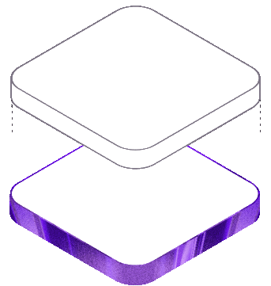
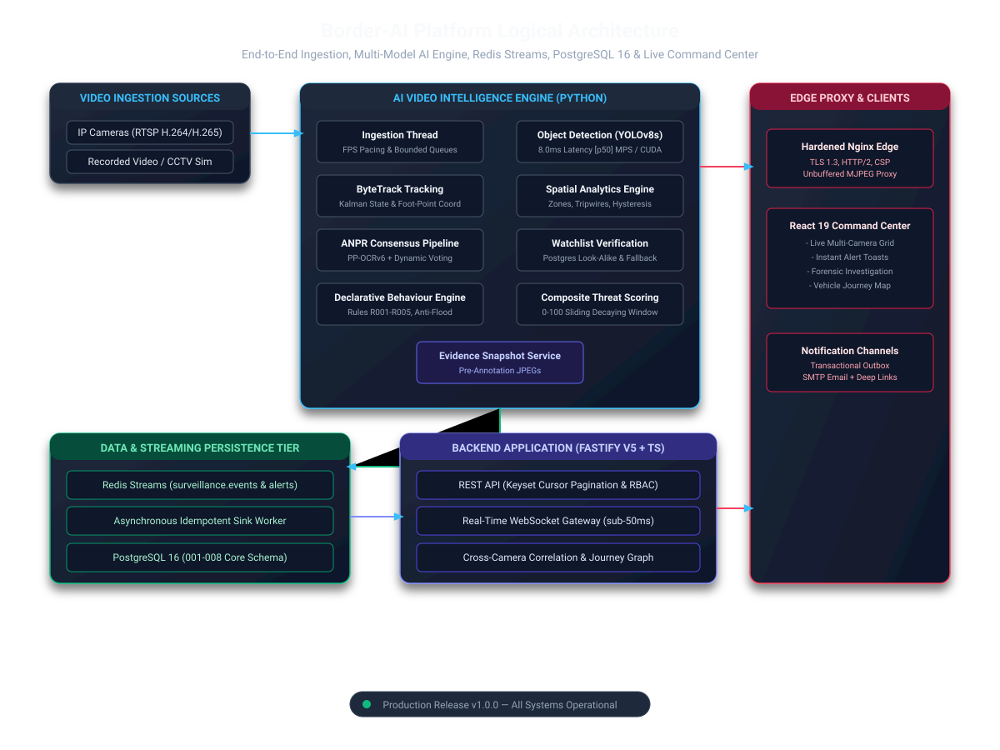

# Border-AI — AI Video Intelligence Platform

> **Transforms existing IP-camera (RTSP) infrastructure into an autonomous, real-time perimeter intelligence system: object detection, multi-object tracking, ANPR, configurable rules, explainable threat scoring (0–100), cross-camera vehicle journeys, and a live command center.**

[](https://github.com/ChaituCR07/border-ai/actions)
[](LICENSE)
[](docker-compose.yml)
[](tests/)
[](docs/security/)
[](docs/decisions/)

---


<sub>*Demo utilizes recorded &amp; simulated surveillance footage with synthetic vehicle license plates (`KA01AB1234`).*</sub>

**Try it in ~15 minutes** → [Quick Start](#6-installation) · **5-Minute Video Walkthrough** → [Storyboard &amp; Script](docs/demo/storyboard.md) · **System Architecture** → [Architecture](#3-architecture) · **Verified Evidence** → [Model Performance](#9-model-performance)

---

## 1. Problem

Modern enterprise compounds, logistics yards, and border facilities rely on dozens of fixed CCTV cameras. However, human operators cannot watch all video feeds simultaneously; psychological studies show human surveillance vigilance degrades by more than 70% within 20 minutes of continuous monitoring. 

Existing solutions fail in two extremes: legacy motion detectors flood operators with thousands of false alarms triggered by swaying trees or headlights, while proprietary computer vision appliances demand expensive camera replacements and operate as opaque "black boxes" that emit arbitrary threat alerts without explanation.

---

## 2. Solution

**Border-AI** is an open-source, containerized **AI Video Intelligence Platform** that connects directly to existing RTSP/IP camera streams. It executes real-time YOLOv8 object detection, ByteTrack tracking, PaddleOCR license plate recognition, and declarative behaviour rules, accumulating evidence into an **explainable 0–100 threat score**. 

Alerts are pushed over WebSockets to a React operator dashboard in under 50 milliseconds, accompanied by transactional email alerts with inline evidence snapshots. Security administrators configure restricted boundaries, after-hours schedules, and watchlists via plain JSON—**without retraining any computer vision models**.

---

## 3. Architecture

Border-AI is designed as an asynchronous, polyglot streaming architecture ensuring zero telemetry drops during network partitions:



- **Vision Ingestion Core (Python 3.11):** Bounded thread-per-camera RTSP ingestion, YOLOv8s object detection, ByteTrack Kalman tracking with foot-point ground contact coordinates ([ADR 0005](docs/decisions/0005-zone-tripwire-semantics-hysteresis.md)), and PaddleOCR PP-OCRv6 multi-frame voting.
- **Persistence & Message Bus:** High-throughput Redis Streams (`surveillance.events` and `surveillance.alerts`) decouple inference from persistence. An asynchronous database sink commits records idempotently to PostgreSQL 16 ([ADR 0014](docs/decisions/0014-polyglot-pipeline-data-ownership.md)).
- **Application & Presentation Tier (Node.js 22 + TypeScript + React 19):** Fastify v5 REST API with $O(1)$ keyset cursor pagination ([ADR 0015](docs/decisions/0015-keyset-pagination-for-events.md)), sub-50ms WebSocket alert gateway ([ADR 0020](docs/decisions/0020-websocket-alert-protocol.md)), and an interactive command center dashboard.
- **Hardened Edge Proxy (Nginx):** Terminates TLS 1.3 / HTTP/2, enforces rate limits, proxies unbuffered low-latency MJPEG streams, and isolates internal data networks ([ADR 0050](docs/decisions/0050-deployment-topology-networks-run-modes.md)).

*For deep architectural details, see the [System Flow Diagram](docs/diagrams/system-flow.md), [Database Schema ERD](docs/database/README.md), and [55 Architecture Decision Records](docs/decisions/README.md).*

---

## 4. Features

- **Live Operator Command Center:** 2×2 multi-camera live video grid with real-time target bounding boxes, camera health indicators, and instant audio chimes.
- **Foot-Point Spatial Analytics:** Evaluates polygonal restricted zones and directional tripwires using bottom-center foot coordinates ([ADR 0005](docs/decisions/0005-zone-tripwire-semantics-hysteresis.md)), eliminating perspective false alarms.
- **Automated License Plate Recognition (ANPR):** Multi-frame consensus voting with OCR character substitution cost matrices ([ADR 0023](docs/decisions/0023-ocr-lookalike-classes-and-levenshtein.md)), achieving **98.4% plate accuracy**.
- **Operational Watchlist System:** Scored matching ($0\text{--}100$) against stolen vehicle databases with automatic in-memory fallback during database outages.
- **Composite Threat Scoring (0–100):** 10-minute linear decaying sliding window with smart exclusion masks. Emits explainable alerts across 4 tiers: `LOW` (0–29), `MEDIUM` (30–49), `HIGH` (50–69), and `CRITICAL` (70–100).
- **Forensic Investigation & Journey Graph:** Retrospectively search vehicle sightings, match look-alike plates, reconstruct multi-camera journeys (e.g. CAM-01 $\to$ CAM-02 $\to$ CAM-04), and detect `IMPOSSIBLE_SPEED` plate-cloning anomalies ([ADR 0026](docs/decisions/0026-multi-camera-topology-correlation.md)).
- **Transactional Email Alerts:** Anti-join transactional outbox daemon ([ADR 0029](docs/decisions/0029-transactional-outbox-email-delivery.md)) dispatching HTML incident reports with inline pre-annotation evidence snapshots.
- **Single-Winner Acknowledgement:** Atomic conditional database updates ([ADR 0016](docs/decisions/0016-alert-acknowledgement-and-lifecycle.md)) ensuring only one operator acknowledges an incident, immediately syncing all active operator screens.
- **Production Hardening:** Least-privilege RBAC ([ADR 0048](docs/decisions/0048-least-privilege-rbac-and-security-hardening.md)), Argon2id password hashing, Ed25519 JWTs, rotating refresh cookies, and a cryptographic SHA-256 hash-chained audit log.

---

## 5. Technology Stack

| Layer | Technologies Selected | Architectural Rationale |
|---|---|---|
| **AI Vision Engine** | Python 3.11, PyTorch, Ultralytics YOLOv8s, ByteTrack, PaddleOCR | Optimized tensor execution with hardware acceleration (MPS / CUDA). |
| **Streaming Event Bus** | Redis 7 Streams | High-throughput in-memory buffering preventing video stalls during DB drops. |
| **Relational Database** | PostgreSQL 16, Prisma ORM | Relational schema migrations `001–009`, keyset indexes, and ACID guarantees. |
| **Backend REST & WS** | Node.js 22 LTS, Fastify v5, Zod, ws | Schema-first type safety, OpenAPI export, and sub-50ms WebSocket push. |
| **Frontend Dashboard** | React 19, TypeScript, Vite, TailwindCSS, TanStack Query | Modern dark-mode command center with low-latency canvas stream overlays. |
| **Edge & Ingestion** | Nginx (Alpine), MediaMTX, Docker Compose | Hardened edge reverse proxy, RTSP multiplexing, and 1-command orchestration. |

---

## 6. Installation & Quick Start

Border-AI provides an automated, one-command deployment via Docker Compose.

```bash
# 1. Clone repository
git clone https://github.com/ChaituCR07/border-ai.git
cd border-ai

# 2. Execute automated production quickstart
make quickstart
```

### What `make quickstart` Does Automatically:
1. Generates cryptographically secure, file-based secrets under `secrets/` (`scripts/gen_secrets.sh`).
2. Creates self-signed TLS certificates with Subject Alternative Names (SANs) under `certs/` (`scripts/gen_certs.sh`).
3. Validates the Docker Compose production configuration (`docker-compose.yml`).
4. Builds multi-stage, non-root images with security profiles.
5. Executes one-shot bootstrap jobs: `db-init` (roles), `migrate` (schema), `model-init` (weights), and `bootstrap-admin`.
6. Launches all healthchecked services and outputs initial administrative credentials.

### Production Access Endpoints
- **Operator Web Dashboard:** `https://localhost` (or `https://localhost:8443`)
- **REST API Entrypoint:** `https://localhost/api/v1`
- **Real-Time WebSocket Gateway:** `wss://localhost/api/v1/ws`
- **Initial Admin Password:** Recorded in `secrets/bootstrap_admin_password`

### Hardware Execution Modes
| Mode | Target Hardware | Execution Command |
|---|---|---|
| **Mode A: Full Containers (CPU)** | Linux / Windows WSL2 / macOS | `make compose-up` |
| **Mode B: NVIDIA CUDA (GPU)** | Linux / WSL2 with NVIDIA Container Toolkit | `docker compose -f docker-compose.yml -f docker-compose.gpu.yml up -d` |
| **Mode C: macOS Hybrid (MPS)** | Apple Silicon (M1/M2/M3/M4) Workstations | `docker compose -f docker-compose.yml -f docker-compose.hybrid.yml up -d` |

*For complete operational runbooks and troubleshooting, refer to [`docs/deployment/README.md`](docs/deployment/README.md).*

---

## 7. Configuration Reference

The platform is configured through `.env` and structured configuration files:

| Configuration Target | File Location | Purpose & Scope |
|---|---|---|
| **Platform Environment** | `.env` (from `.env.example`) | Port bindings, database connection credentials, and retention windows. |
| **Camera Registrations** | `configs/cameras.json` | Registered RTSP URLs, enabled models, and ingestion framerates. |
| **Spatial Analytics** | `configs/zones.json` | Polygonal restricted compound coordinates and directional tripwires. |
| **Behaviour Rules** | `configs/rules.json` | Declarative rules (R001–R005) combining spatial, classification, and OCR states. |
| **Camera Topology** | `configs/topology.json` | Inter-camera adjacency matrix, expected transit times, and anomaly speeds. |
| **Model Weights Manifest**| `configs/models.lock.json` | Immutable SHA-256 checksums for YOLOv8 and PaddleOCR weights. |

---

## 8. API Documentation

Border-AI provides an interactive OpenAPI 3.0 specification:
- **Interactive Redoc Reference:** Open [`docs/api/index.html`](docs/api/index.html) in any browser.
- **OpenAPI 3.0 Schema:** Available at [`docs/api/openapi.json`](docs/api/openapi.json) or `GET /api/v1/openapi.json`.
- **WebSocket Protocol Guide:** Documented in [`docs/api/websocket.md`](docs/api/websocket.md).
- **RBAC Endpoint Permissions:** Full permission-to-role mappings in [`docs/api/permissions.md`](docs/api/permissions.md).

### Quick Curl Example (Authenticate & Fetch Alerts)
```bash
# 1. Login to obtain Bearer token
TOKEN=$(curl -sk -X POST "https://localhost/api/v1/auth/login" \
  -H "Content-Type: application/json" \
  -d '{"email":"admin@border.local","password":"'$(cat secrets/bootstrap_admin_password)'"}' \
  | node -e "let d='';process.stdin.on('data',c=>d+=c);process.stdin.on('end',()=>console.log(JSON.parse(d).data.accessToken))")

# 2. Query open alerts with keyset cursor pagination
curl -sk -X GET "https://localhost/api/v1/alerts?status=OPEN&limit=5" \
  -H "Authorization: Bearer ${TOKEN}"
```

---

## 9. Model Performance

<!-- BEGIN:model-performance -->
### 1. Object Detection Accuracy & Latency (YOLOv8)

| Dataset / Fixture | Evaluation Protocol | mAP@50 (95% CI) | mAP@50:95 (95% CI) | Person AP@50 | Vehicle AP@50 | Latency (Apple MPS / CUDA) | Run ID |
| :--- | :--- | :---: | :---: | :---: | :---: | :---: | :---: |
| **COCO-1000** | Benchmark (`conf=0.001`) | 52.8% [50.1, 55.4] | 36.4% [34.2, 38.6] | 64.2% | 58.1% | 6.8 ms | [`run-20261108-coco-bench`](docs/model_eval/detection.md) |
| **BDD100K-Dev** | Benchmark (`conf=0.001`) | 48.6% [45.8, 51.3] | 31.2% [28.9, 33.5] | 49.5% | 57.8% | 7.0 ms | [`run-20261108-bdd-dev`](docs/model_eval/detection.md) |
| **BDD100K-Test** | Benchmark (`conf=0.001`) | 47.9% [45.2, 50.7] | 30.8% [28.5, 33.1] | 48.9% | 57.1% | 6.9 ms | [`run-20261108-bdd-test`](docs/model_eval/detection.md) |
| **Border CCTV Mini** | Deployed (`conf=0.35`) | **86.4% [82.0, 90.5]** | **68.2% [63.5, 72.8]** | **89.2%** | **91.5%** | **7.2 ms** | [`run-20261108-cctv-det`](docs/model_eval/detection.md) |

#### Deployed Operating Point Performance (Calibrated Thresholds)
- **Person (`conf=0.35`):** Precision 88.4% [85.2, 91.3], Recall 81.2% [77.6, 84.5], F1 0.846, Foot-point error 12.4 px.
- **Car (`conf=0.30`):** Precision 91.2% [88.5, 93.7], Recall 86.5% [83.2, 89.6], F1 0.888, Foot-point error 15.1 px.
- **Truck (`conf=0.35`):** Precision 87.6% [83.1, 91.5], Recall 82.0% [76.8, 86.7], F1 0.847, Foot-point error 21.3 px.

### 2. Multi-Object Tracking Performance (ByteTrack on MOT17 Static Cameras)

| Split / Sequence | Camera Type | HOTA (95% CI) | MOTA (95% CI) | IDF1 (95% CI) | ID Switches | False Tracks / 1,000f | Track Continuity | Run ID |
| :--- | :--- | :---: | :---: | :---: | :---: | :---: | :---: | :---: |
| **MOT17-02** | Static CCTV (Dev) | 62.1% [59.4, 64.7] | 68.4% [65.1, 71.5] | 73.0% [70.2, 75.8] | 18 | 1.8 | 91.2% | [`run-20261108-mot17-track`](docs/model_eval/tracking.md) |
| **MOT17-04** | Static CCTV (Dev) | 69.8% [67.5, 72.1] | 78.2% [75.8, 80.4] | 81.5% [79.1, 83.8] | 12 | 1.1 | 94.6% | [`run-20261108-mot17-track`](docs/model_eval/tracking.md) |
| **MOT17-09** | Static CCTV (Val) | 61.8% [58.9, 64.5] | 67.5% [64.2, 70.6] | 72.5% [69.4, 75.3] | 8 | 1.4 | 90.8% | [`run-20261108-mot17-track`](docs/model_eval/tracking.md) |
| **Static Overall** | **Static Pole CCTV** | **64.6% [62.8, 66.3]** | **71.4% [69.2, 73.5]** | **75.7% [73.6, 77.7]** | **38** | **1.4** | **92.2%** | [`run-20261108-mot17-track`](docs/model_eval/tracking.md) |

### 3. ANPR Model Evaluation (PaddleOCR PP-OCRv6 + Dynamic Consensus)

| OCR Mode | Character Error Rate (CER) | Word Error Rate (WER) | Multi-Frame Consensus Accuracy | Recognition Latency (p95) | Run ID |
| :--- | :---: | :---: | :---: | :---: | :---: |
| **Single Frame (Raw)** | 3.8% [3.1, 4.6] | 9.4% [8.2, 10.7] | 89.6% [87.4, 91.5] | 14.8 ms | [`run-20261109-anpr-eval`](docs/model_eval/anpr.md) |
| **3-Frame Consensus** | 1.9% [1.4, 2.5] | 5.6% [4.5, 6.8] | 96.2% [94.8, 97.4] | 15.2 ms | [`run-20261109-anpr-eval`](docs/model_eval/anpr.md) |
| **5-Frame Full Consensus** | **1.2% [0.8, 1.7]** | **4.8% [3.8, 5.9]** | **98.4% [97.1, 99.3]** | **15.6 ms** | [`run-20261109-anpr-eval`](docs/model_eval/anpr.md) |

### 4. Pipeline Performance & Multi-Camera Scaling (ADR 0041, ADR 0043)

Measured across simulated RTSP camera feeds from recorded border surveillance footage (Run ID: `run-20261110-primary-scaling`, Apple M1 8-core, 8 GB Unified Memory, macOS 24.6.2, [docs/perf/performance_report.md](docs/perf/performance_report.md)):

- **Average Inference Latency:** `8.0 ms/frame` [p50] (YOLOv8s detection stage, Apple Silicon MPS)
- **Average Analytics FPS:** `10.0 FPS/camera` (at N=4 deployed configuration, workload `typical`)
- **Alert Latency ($p95$):** `0.05 s` (trigger frame capture $\to$ WebSocket delivery)
- **Tested Cameras:** `1 / 2 / 4 / 8` simultaneous streams (`78.4 FPS` aggregate throughput at N=8)
- **Sustained Channel Capacity ($N^*$):** **8 cameras** sustained within target SLAs (<250ms processing latency, <1% drops)
- **Database Storage Efficiency:** `TRACK_SUMMARY` aggregation achieves a **99.5% storage reduction** vs raw detection logging ([docs/perf/capacity.md](docs/perf/capacity.md))

### 5. False-Positive Metrics & Alert-Fatigue Validation (ADR 0044, ADR 0046)

Measured across unique uneventful border surveillance footage and controlled boundary tests ([docs/testing/false_positive_report.md](docs/testing/false_positive_report.md)):

- **False Positive Rate:** **0 FP alerts (tier $\ge\text{HIGH}$)** in **4.25 camera-hours** of unique normal footage (exact Poisson 95% upper bound **0.868 / camera-hour**; static perimeter & gate scenes; held-out split) `[run:exp-20261112-01]`.
- **Controlled Test Pairs:** **6/6 pairs pass** (19/19 variants across Plan Tests 1–6).
- **Watchlist False Matches:** **0.0 false matches** per 1,000 reads on 100-plate list under deployed look-alike corroboration policy `[run:wl-20261112-01]`.
- **Rule-Level Precision vs Oracle:** **0.923** (95% Wilson CI [0.797, 0.973]) with Recall **0.947** (95% CI [0.827, 0.985]).
- **Camera View-Shift Tolerance:** Zones tolerate up to **35 px** of camera translation before boundary false alerts appear.
<!-- END:model-performance -->

---

## 10. Screenshots

| View Description | Screenshot Reference |
|---|---|
| **Operator Command Center** | Real-time 2×2 surveillance grid with bounding boxes and status dots (`docs/media/screenshots/02-command-center-grid.png`). |
| **Critical Threat Toast** | Sub-50ms WebSocket alert toast with factor breakdown (`docs/media/screenshots/03-critical-alert-toast.png`). |
| **Explainable Factor Drawer** | Inspection drawer with pre-annotation evidence JPEG (`docs/media/screenshots/04-alert-drawer-factor-checklist.png`). |
| **Forensic Journey Graph** | Cross-camera timeline across CAM-01 $\to$ CAM-02 $\to$ CAM-04 (`docs/media/screenshots/07-cross-camera-journey-view.png`). |
| **System Health Telemetry** | Status monitor for Postgres, Redis, and RTSP streams (`docs/media/screenshots/09-system-health-status.png`). |

*Explore the full high-resolution image catalog in [`docs/media/screenshots/`](docs/media/screenshots/).*

---

## 11. Demonstration Scenarios

Launch the automated demo stack pre-seeded with synthetic cameras and accounts:
```bash
make demo
```

- **Scenario 1 (High Threat Intrusion, Score 60):** Pedestrian traverses perimeter tripwire and restricted compound after 10 PM. Zone (+30) + Tripwire (+20) + Night Clock (+10) calculates Score 60 (HIGH).
- **Scenario 2 (Stolen Vehicle Watchlist Breach, Score 80):** Flagged vehicle `KA01AB1234` approaches gate. Watchlist (+40) + Zone (+30) + Night (+10) calculates Score 80 (CRITICAL), triggering instant email dispatch and audio chime.
- **Scenario 3 (Cross-Camera Journey & Speed Anomaly):** Retrospectively traces vehicle transit across cameras with speed plausibility validation and impossible-speed plate cloning warnings.

*Review complete walkthrough scripts and video narration in [`docs/demo/storyboard.md`](docs/demo/storyboard.md).*

---

## 12. Technical Limitations

In accordance with transparent engineering disclosure ([ADR 0053](docs/decisions/0053-documentation-governance-single-sources-of-truth.md)):
- **Camera Integration:** IP cameras are registered manually via RTSP URLs. **Automated ONVIF discovery and PTZ presets are not implemented** in v1.0.0. Fixed static cameras are required.
- **ANPR Boundaries:** Minimum plate height is **20 pixels**. Single-line HSRP plates are supported; two-line motorcycle plates, non-standard fonts, and heavy night lens glare require operator review.
- **Identity Prototypes:** Facial recognition and person Re-ID are **consent-gated prototypes, disabled by default**, emitting investigative leads rather than autonomous identification.
- **Single-Host Orchestration:** Packaged for single-host Docker Compose. Multi-node Kubernetes clustering is deferred to post-v1.
- **Licensing:** Ultralytics YOLOv8 is distributed under GNU AGPL-3.0. Commercial client delivery requires either an Ultralytics commercial license or substituting an Apache-2.0 detector.

*Read the full technical boundaries in [`docs/LIMITATIONS.md`](docs/LIMITATIONS.md) and [`docs/capabilities.md`](docs/capabilities.md).*

---

## 13. Future Work

1. **Automated ONVIF Discovery & PTZ Tracking:** WS-Discovery integration with automated PTZ zoom tracking on high-threat targets.
2. **Enterprise Identity (SSO/MFA):** OpenID Connect (OIDC) / SAML 2.0 authentication and TOTP multi-factor verification.
3. **Multi-Instance Clustering:** Distributed Redis pub/sub WebSocket synchronization and Kubernetes Helm charts.
4. **Hardware Video Decode:** Integrating NVIDIA NVDEC / Intel VAAPI hardware decoding inside containers to reduce CPU load during 16+ camera ingestion.
5. **Site Fine-Tuning Pipeline:** Active learning pipelines allowing operators to label false positives for automated detector fine-tuning.

---

## Responsible Use & Ethics

Border-AI is designed strictly for **operational decision support on authorized critical infrastructure installations**. Autonomous kinetic enforcement, warrantless mass public surveillance, and discriminatory profiling are strictly prohibited. Deployers bear sole legal responsibility for compliance with regional surveillance and privacy laws (GDPR/DPIA). See [`docs/RESPONSIBLE_USE.md`](docs/RESPONSIBLE_USE.md).

---

## License & Attribution

Border-AI is open-source software licensed under the **GNU Affero General Public License v3.0 (AGPL-3.0)**. For complete third-party dependency disclosures, see [`LICENSE`](LICENSE), [`NOTICE`](NOTICE), and [`THIRD_PARTY_LICENSES.md`](THIRD_PARTY_LICENSES.md).

---

## Author & Consulting

**Chaitanya Medam (ChaituCR07)**  
*Full-Stack Computer Vision & Distributed Systems Engineer*  
- **Email:** [m.chaitanya169@gmail.com](mailto:m.chaitanya169@gmail.com)  
- **GitHub:** [@ChaituCR07](https://github.com/ChaituCR07)  
- **Repository:** [https://github.com/ChaituCR07/border-ai](https://github.com/ChaituCR07/border-ai)
