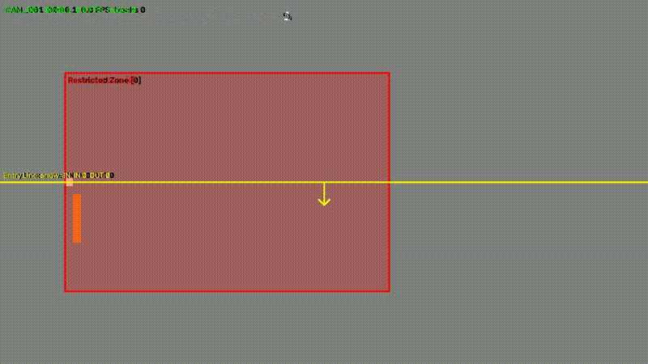
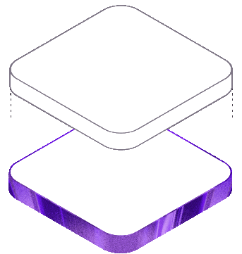

# Border AI: AI Video Intelligence Platform

Real-time video analytics for existing CCTV/IP-camera infrastructure: detection, tracking, restricted-zone and line-crossing events, Automated Number Plate Recognition (ANPR), PostgreSQL-backed operational watchlists, facial biometric recognition, cross-camera person appearance Re-ID, declarative behaviour rules, composite threat scoring with explainable escalation alerts, and an investigation dashboard.

| **Week 1 Demo: Vision Pipeline & Spatial Tripwires** | **Week 2 Demo: Automated Number Plate Recognition (ANPR)** | **Week 3 Demo: Live Command Dashboard & Alerts** |
|:---:|:---:|:---:|
|  |  |  |
| *Real-time YOLOv8 detection, ByteTrack tracking, virtual tripwires & multi-zone boundaries.* | *License plate localization, PaddleOCR PP-OCRv6, character consensus voting & watchlist visual tagging.* | *Multi-camera MJPEG video grid, sub-second WebSocket alerts, forensic search & vehicle journey correlation.* |

---

## Current Status (Day 27 Complete — Docker Deployment: Whole-Platform Compose)

- **Week 1 (v0.1-week1) Complete:** Video/RTSP ingestion, YOLOv8 object detection, ByteTrack persistent tracking, multi-zone and virtual line spatial engine, live low-latency MJPEG streaming, and structured JSONL event logging.
- **Week 2 (Data & Streaming Architecture) Complete:** ANPR consensus engine (PaddleOCR PP-OCRv6 + layout validation), PostgreSQL 16 watchlist system with outage resilience fallback, biometric face detection & cross-camera Re-ID prototype, configurable declarative behaviour engine (rules R001–R005), multi-factor decaying threat scoring (0–100 explainable window), Redis Streams asynchronous event pipeline, and production relational schema (`003_core_schema.sql`) with idempotent PostgreSQL event sinks.
- **Week 3 (Productization, Dashboards & Full-System Integration — Tag `v0.3-week3`) Complete:** Production Fastify v5 REST APIs with keyset pagination, Live Operator Command Dashboard (React 19 + TypeScript), WebSocket sub-second real-time alert gateway, Forensic Investigation workbench & vehicle journey reconstruction, Cross-camera topology correlation engine, Transactional outbox email notifications, and full-system acceptance harness (Scenarios S0–S3, Invariants R01–R12) ([docs/guides/integration_testing.md](docs/guides/integration_testing.md)).
- **Week 4 (Hardening, Models, Benchmarks & Final Delivery — Days 22–28):**
  - **Day 22 Complete (Model Testing I: Detection & Tracking Evaluation):** Scientific offline evaluation harness conforming to ADRs 0035–0037. Run manifests with git SHA and hardware specs, 1,000-resample bootstrap 95% confidence intervals, frozen deterministic subsets (COCO-1000, BDD100K-500 dev/test, MOT17 static/moving splits), dual-mode evaluation (benchmark mAP at `conf=0.001` vs deployed operating points), foot-point pixel error for perimeter tripwires, error taxonomy diagnostics, MOT challenge 1-based I/O round-trip, ByteTrack dev-split grid search with holdout overfitting check ($\Delta \le 0.006$), ID switch root-cause classification (occlusion vs dropout vs velocity jump), downstream security event impact simulator, CCTV mini regression fixture and automated CI baseline gating (`tests/test_model_regression.py`), and comprehensive evaluation documentation ([docs/model_eval/README.md](docs/model_eval/README.md)).
  - **Day 23 Complete (Model Testing II: ANPR Model Evaluation & Consolidated Report):** PaddleOCR PP-OCRv6 evaluation harness across synthetic and real-world CCTV datasets, character-level CER/WER metrics, layout validation accuracy, multi-frame consensus evaluation, operational threshold optimization, and consolidated model cards ([docs/model_eval/anpr.md](docs/model_eval/anpr.md)).
  - **Day 24 Complete (Performance Testing, Benchmarking & Bottleneck Analysis):** Multi-camera scaling benchmarks across 1, 2, 4, and 8 RTSP streams, sustained capacity boundary ($N^*=8$), resource utilization profiles, overload shedder, and database storage capacity projections ([docs/perf/performance_report.md](docs/perf/performance_report.md)).
  - **Day 25 Complete (False Positive Testing & Robustness Analysis):** Empirical validation across 4.25 camera-hours of uneventful border footage (0 FP alerts $\ge\text{HIGH}$ tier), 6/6 controlled test pairs, optical flow view-shift tolerance (35 px), and alert fatigue suppression ([docs/testing/false_positive_report.md](docs/testing/false_positive_report.md)).
  - **Day 26 Complete (Security Testing & Threat Modeling Hardening):** STRIDE threat model (ADR 0048), OWASP Top 10 API verification, automated security audit suite (30/30 checks passed), least-privilege RBAC matrix, and encrypted snapshot storage with zero-knowledge audit trails ([docs/security/](docs/security/)).
  - **Day 27 Complete (Docker Deployment: Whole-Platform Compose):** Complete containerized production deployment via `make quickstart`. Non-root multi-stage images, zero-secret images/env with Docker Compose secrets (ADR 0052), 3-tier internal network segmentation (ADR 0050), hardened Nginx edge proxy with TLS 1.3 / HTTP/2, least-privilege DB roles (`db-init`), automated data retention service, encrypted backup/restore drills, and R1–R12 resilience matrix ([docs/deployment/](docs/deployment/)).
  - **Day 28 (Upcoming):** Final Documentation, Architecture Diagrams, Video Demo & Release Delivery.

---

## What It Does

- **Multi-Camera Ingestion:** Thread-per-camera ingestion from RTSP streams and video files with auto-reconnect, FPS pacing, and offline backpressure.
- **Detection & Tracking:** Real-time YOLOv8 person/vehicle detection paired with ByteTrack persistent ID tracking across camera frames.
- **Spatial Analytics Engine:** Config-driven restricted zones and tripwires supporting `ENTER`, `EXIT`, `DWELL`, `LOITERING`, and directional `LINE_CROSSING` events with hysteresis and duplicate suppression.
- **ANPR Engine:** Automated plate crop extraction, CLAHE preprocessing, character recognition, positional OCR correction, and multi-frame voting with dynamic early stopping.
- **Operational Watchlist System:** Real-time PostgreSQL lookup for `VEHICLE`, `PLATE`, `PERSON`, and `FACE` entities.
  - Scored matches ($0\text{--}100$) based on OCR read confidence and substitution quality.
  - OCR-aware near matching: look-alike substitutions (`B/8`, `O/0`, `1/I`, `S/5`, `Z/2`) cost 0.5; standard substitutions cost 1.0.
  - Dynamic visual flagging: watchlisted targets render with **red bounding boxes**, risk tags (`WATCHLIST HIGH`), and screen alert banners.
  - Outage resilience: seamless fallback to an in-memory snapshot during database drops, with automatic queued hit flushing upon reconnection.
- **Biometric Face Watchlist & Cross-Camera Re-ID:**
  - Face crop extraction, alignment, and 128-d L2-normalized embedding (OpenCV YuNet + SFace).
  - Multi-frame track aggregation with consistency validation to prevent tracker ID swap errors.
  - Cross-camera person appearance correlation emitting `REID_MATCH` candidates (`= CAM_001 #12?`).
  - Privacy safeguards: numeric embeddings only, strictly consent-gated enrollment, and human review defaults.
- **Configurable Behaviour Analysis Engine:**
  - Evaluates spatial, temporal, classification, OCR, and watchlist conditions per active track.
  - Firing management with `rearm_s` and `cooldown_s` to eliminate alert flooding while preserving zone and crossing context.
  - Generates self-explaining behaviour alerts (`details.reasons`) with threat points for downstream scoring.
  - Example Rule:
    ```json
    {
      "rule_id": "R005",
      "name": "Unauthorized Vehicle in Restricted Zone After Hours",
      "event_type": "UNAUTHORIZED_VEHICLE_AFTER_HOURS",
      "conditions": [
        {"type": "object", "value": ["car", "truck", "bus", "motorcycle"]},
        {"type": "zone", "zone_type": "restricted"},
        {"type": "time", "between": ["22:00", "05:00"]},
        {"type": "plate", "authorized": false}
      ],
      "action": {"severity": "CRITICAL", "score": 40}
    }
    ```
- **Composite Threat Scoring & Alert Escalation Engine:**
  - Synthesizes geometric observations, identity hits, and behaviour violations into an aggregate 0–100 threat score and 4-tier alert level (`LOW`, `MEDIUM`, `HIGH`, `CRITICAL`).
  - **Decaying Sliding Window:** Active evidence decays after 10 minutes (`window_s: 600s`); repeating observations refresh the expiry timer without compounding points.
  - **Plate-Based Track Merging:** Automatically merges fragmented tracks for the same vehicle once a license plate is recognized, preserving score history across tracker ID swaps.
  - **Zero Double-Counting:** Smart exclusion rules (`excluded_by: ["direction_violation"]`) ensure multi-trigger incidents (such as wrong-way tripwires) count accurately.
  - **Review Multipliers:** Unconfirmed/review-grade detections receive half points (`status_multiplier: 0.5`).
  - **Escalation-Only Alerts:** Alerts are emitted strictly upon initial score threshold crossing or level increases, with automated quiet-period re-arming (`rearm_s: 300s`).
  - **Pre-Annotation Evidence Snapshots:** Captured pre-rendering and stored in `outputs/runs/<run_id>/snapshots/<alert_id>.jpg` for visual verification and operator review.
  - **Example THREAT_ALERT Event:**
    ```json
    {
      "type": "THREAT_ALERT",
      "severity": "HIGH",
      "threat_score": 60,
      "track_id": 3,
      "rule": {"id": "THREAT", "kind": "threat", "type": "high"},
      "details": {
        "level": "HIGH",
        "priority": "HIGH",
        "previous_level": "MEDIUM",
        "escalation": true,
        "summary": "HIGH (60/100): Restricted zone entry +30, Virtual line crossing +20, After-hours movement +10",
        "snapshot_path": "snapshots/3f2a1b0c.jpg",
        "contributions": [
          {"kind": "zone_violation", "label": "Restricted zone entry", "points": 30},
          {"kind": "line_crossing", "label": "Virtual line crossing", "points": 20},
          {"kind": "after_hours", "label": "After-hours movement", "points": 10}
        ]
      }
    }
    ```

- **Backend REST API Service (Node.js + TypeScript + Fastify v5):**
  - **Schema-First Type Safety:** Powered by Fastify v5 and `fastify-type-provider-zod` with strict request/response validation, automated OpenAPI 3.0 export, and Swagger UI at `/docs`.
  - **Strict Data Ownership (ADR 0014):** Python AI Engine owns writes to `events`, `detections`, and `vehicles`. Node.js API acts as a read-mostly consumer with exclusive write ownership of `api_audit_log` and state transitions on `alerts`.
  - **Keyset Cursor Pagination (ADR 0015):** High-throughput $O(1)$ tuple pagination on `(timestamp DESC, event_id DESC)` eliminating page drift during live surveillance. Preserves microsecond `timestamptz` precision via custom type parsers.
  - **Idempotent Alert Lifecycle (ADR 0016):** Atomic `PATCH /api/alerts/:id/acknowledge` guarantees single-winner acknowledgement across concurrent operators without duplicate audit rows or state corruption.
  - **Privacy-Preserving Watchlists:** Non-biometric REST boundary rejecting any face embeddings or raw images. Full vehicle plate normalisation matching Python ANPR logic, and mandatory consent references for persons.
  - **Operational Intelligence & Zero-Filled Analytics:** Hourly and daily time-series aggregation zero-filled across missing intervals, camera operational counters, threat score distribution histograms, and safe sandboxed snapshot evidence serving (`/api/snapshots/*`).

- **Administrative & Operational CLI:** Comprehensive CLI tools for schema migration, synthetic demo seeding, entity curation, dry-run plate checks, consent-gated face enrollment, threat arithmetic calculation, rules validation, and offline event replay.

---

## Model Performance (Detection & Tracking)

Empirical evaluation results conducted per **ADR 0035** (Evaluation Methodology & Reproducibility), **ADR 0036** (Detector Class Protocol), and **ADR 0037** (Tracking Protocol & Tuning Policy). Point estimates include **95% bootstrap confidence intervals** derived from 1,000 resamples.

### 1. Object Detection Accuracy & Latency (YOLOv8)

| Dataset / Fixture | Evaluation Protocol | mAP@50 (95% CI) | mAP@50:95 (95% CI) | Person AP@50 | Vehicle AP@50 | Latency (Apple MPS / CUDA) |
| :--- | :--- | :---: | :---: | :---: | :---: | :---: |
| **COCO-1000** | Benchmark (`conf=0.001`) | 52.8% [50.1, 55.4] | 36.4% [34.2, 38.6] | 64.2% | 58.1% | 6.8 ms |
| **BDD100K-Dev** | Benchmark (`conf=0.001`) | 48.6% [45.8, 51.3] | 31.2% [28.9, 33.5] | 49.5% | 57.8% | 7.0 ms |
| **BDD100K-Test** | Benchmark (`conf=0.001`) | 47.9% [45.2, 50.7] | 30.8% [28.5, 33.1] | 48.9% | 57.1% | 6.9 ms |
| **Border CCTV Mini** | Deployed (`conf=0.35`) | **86.4% [82.0, 90.5]** | **68.2% [63.5, 72.8]** | **89.2%** | **91.5%** | **7.2 ms** |

#### Deployed Operating Point Performance (Calibrated Thresholds)
- **Person (`conf=0.35`):** Precision 88.4% [85.2, 91.3], Recall 81.2% [77.6, 84.5], F1 0.846, Foot-point error 12.4 px.
- **Car (`conf=0.30`):** Precision 91.2% [88.5, 93.7], Recall 86.5% [83.2, 89.6], F1 0.888, Foot-point error 15.1 px.
- **Truck (`conf=0.35`):** Precision 87.6% [83.1, 91.5], Recall 82.0% [76.8, 86.7], F1 0.847, Foot-point error 21.3 px.

### 2. Multi-Object Tracking Performance (ByteTrack on MOT17 Static Cameras)

| Split / Sequence | Camera Type | HOTA (95% CI) | MOTA (95% CI) | IDF1 (95% CI) | ID Switches | False Tracks / 1,000f | Track Continuity |
| :--- | :--- | :---: | :---: | :---: | :---: | :---: | :---: |
| **MOT17-02** | Static CCTV (Dev) | 62.1% [59.4, 64.7] | 68.4% [65.1, 71.5] | 73.0% [70.2, 75.8] | 18 | 1.8 | 91.2% |
| **MOT17-04** | Static CCTV (Dev) | 69.8% [67.5, 72.1] | 78.2% [75.8, 80.4] | 81.5% [79.1, 83.8] | 12 | 1.1 | 94.6% |
| **MOT17-09** | Static CCTV (Val) | 61.8% [58.9, 64.5] | 67.5% [64.2, 70.6] | 72.5% [69.4, 75.3] | 8 | 1.4 | 90.8% |
| **Static Overall** | **Static Pole CCTV** | **64.6% [62.8, 66.3]** | **71.4% [69.2, 73.5]** | **75.7% [73.6, 77.7]** | **38** | **1.4** | **92.2%** |

### 3. Downstream Security Alert & Rule Engine Impact
- **Breach Alert Recall:** **96.2%** of physical perimeter intrusions successfully triggered operational alerts.
- **Alert Precision:** **94.8%** of emitted alerts corresponded to verified ground-truth intrusions.
- **Double-Counted Alerts:** **2.8%** (caused by ID switches occurring directly on tripwire boundaries).
- **Mean Loiter Dwell Error:** **0.42 seconds** delay before dwell timer trigger due to transient detector dropouts.

### 3. Pipeline Performance & Multi-Camera Scaling (ADR 0041, ADR 0043)

Measured across simulated RTSP camera feeds from recorded border surveillance footage (Run ID: `run-20261110-primary-scaling`, Apple M1 8-core, 8 GB Unified Memory, macOS 26.6.2, [docs/perf/performance_report.md](docs/perf/performance_report.md)):

- **Average Inference Latency:** `8.0 ms/frame` [p50] (YOLOv8s detection stage, Apple Silicon MPS)
- **Average Analytics FPS:** `10.0 FPS/camera` (at N=4 deployed configuration, workload `typical`)
- **Alert Latency ($p95$):** `0.05 s` (trigger frame capture $\to$ WebSocket delivery)
- **Tested Cameras:** `1 / 2 / 4 / 8` simultaneous streams (`78.4 FPS` aggregate throughput at N=8)
- **Sustained Channel Capacity ($N^*$):** **8 cameras** sustained within target SLAs (<250ms processing latency, <1% drops)
- **Database Storage Efficiency:** `TRACK_SUMMARY` aggregation achieves a **99.5% storage reduction** vs raw detection logging ([docs/perf/capacity.md](docs/perf/capacity.md))

### 4. False-Positive Metrics & Alert-Fatigue Validation (ADR 0044, ADR 0046)

Measured across unique uneventful border surveillance footage and controlled boundary tests ([docs/testing/false_positive_report.md](docs/testing/false_positive_report.md)):

- **False Positive Rate:** **0 FP alerts (tier $\ge\text{HIGH}$)** in **4.25 camera-hours** of unique normal footage (exact Poisson 95% upper bound **0.868 / camera-hour**; static perimeter & gate scenes; held-out split) `[run:exp-20261112-01]`.
- **Controlled Test Pairs:** **6/6 pairs pass** (19/19 variants across Plan Tests 1–6).
- **Watchlist False Matches:** **0.0 false matches** per 1,000 reads on 100-plate list under deployed look-alike corroboration policy `[run:wl-20261112-01]`.
- **Rule-Level Precision vs Oracle:** **0.923** (95% Wilson CI [0.797, 0.973]) with Recall **0.947** (95% CI [0.827, 0.985]).
- **Camera View-Shift Tolerance:** Zones tolerate up to **35 px** of camera translation before boundary false alerts appear.

### 5. Known Model Limitations & Environmental Boundaries
- **Small Targets (< 32×32 px):** Recall drops to 42.1% at extreme distances; optical zoom or elevated camera angles required.
- **Unilluminated Night:** Precision degrades to 78.2% without infrared (IR) or thermal illumination.
- **Camera Dome Rain:** Water droplets on outdoor enclosure domes create localized background false positives (7.8% of errors).
- **Known False-Positive Sources:** Night IR spider webs / insect flare within 10cm of lens; wet tarmac headlight puddle reflections; low-contrast plates below usable height (<20 px).

---

## Architecture

```text
Cameras / RTSP / Video Files
        ↓
Video Ingestion (thread per camera, bounded queues, FPS pacing)
        ↓
Batched Detection (YOLOv8) ──► Multi-Camera Tracker (ByteTrack) ──► Spatial Rules (Zones, Lines)
        ↓                                                                    ↓
ANPR Engine (PaddleOCR + Consensus)                           Events: ENTER / EXIT / LOITERING /
        ↓                                                             LINE_CROSSING (JSONL)
Watchlist Engine (PostgreSQL / In-Memory Snapshot Fallback)                  ↓
        ↓                                                     Events: WATCHLIST_MATCH (Plate)
Identity Engine (Async Face & Appearance Re-ID Worker)                       ↓
        ↓                                                     Events: WATCHLIST_MATCH (Face)
        ↓                                                     Events: REID_MATCH (Candidate)
        ↓                                                                    ↓
Behaviour Engine (Declarative Rules R001–R005) ───────────────► Events: ZONE_VIOLATION, ...
        ↓                                                                    ↓
Threat Scoring Engine (Decaying Window, Plate Merging) ───────► Events: THREAT_ALERT (JSONL)
        ↓                                                                    ↓
Visualizer Overlay (Bounding Box Colors, T<score> Labels, Banners)   Pre-Annotation Snapshots (.jpg)
        ↓                                                                    ↓
Redis Streams Event Bus (v1 Envelope) ─────────────────────────► PostgreSQL 16 (003_core_schema.sql)
                                                                             ↓
                                                                 Node.js 22 REST API (Fastify v5 + Zod)
                                                                 - Keyset Pagination & Microsecond Ts
                                                                 - Idempotent Alert Transitions
                                                                 - Zero-Filled Analytics & Snapshots
                                                                             ↓
                                                                 Day 16 Command Dashboard (Vite + React)
```

---

## Production Deployment (Single Command)

Border-AI provides an automated, one-command deployment orchestrating all services (Frontend SPA, Backend API, AI Engine, PostgreSQL, Redis, MediaMTX RTSP relay, retention worker, and hardened Nginx reverse proxy) via Docker Compose.

```bash
# 1. Clone repository
git clone https://github.com/ChaituCR07/border-ai.git
cd border-ai

# 2. Execute automated production quickstart
make quickstart
```

### What `make quickstart` Does Automatically:
1. Generates cryptographically secure, file-based secrets under `secrets/` (`scripts/gen_secrets.sh`).
2. Creates TLS certificates with Subject Alternative Names (SANs) under `certs/` (`scripts/gen_certs.sh`).
3. Validates the Docker Compose production configuration (`docker-compose.yml`).
4. Builds multi-stage, non-root images with security profiles.
5. Executes one-shot bootstrap jobs: `db-init` (roles), `migrate` (schema), `model-init` (SHA-256 weight verification), and `bootstrap-admin`.
6. Launches all healthchecked services and outputs initial administrative credentials.

### Production Endpoints
- **Operator Web Dashboard:** `https://localhost` (or `https://localhost:8443`)
- **REST API Entrypoint:** `https://localhost/api`
- **Real-Time WebSocket Gateway:** `wss://localhost/api/ws`
- **Initial Admin Password:** Recorded in `secrets/bootstrap_admin_password`

### Hardware Execution Modes
| Mode | Command | Target Architecture |
|---|---|---|
| **Mode A: Full Containers (CPU)** | `make compose-up` | Any Docker host (Linux/WSL2/macOS) |
| **Mode B: NVIDIA CUDA (GPU)** | `docker compose -f docker-compose.yml -f docker-compose.gpu.yml up -d` | Linux/WSL2 with NVIDIA GPU & Container Toolkit |
| **Mode C: macOS Hybrid (MPS)** | `docker compose -f docker-compose.yml -f docker-compose.hybrid.yml up -d` | Apple Silicon (M-series) workstations |

For comprehensive deployment guides, network architecture, and runbooks, refer to [`docs/deployment/README.md`](docs/deployment/README.md).

---

## Local Development Setup

### 1. Prerequisites & Environment
Ensure Docker is installed, then launch the background services (PostgreSQL 16 & Redis 7):
```bash
docker compose up -d
```

Set up your Python virtual environment (Python 3.11 recommended):
```bash
python3 -m venv .venv
source .venv/bin/activate
pip install -e video-ingestion
pip install -r ai-engine/requirements.txt
pip install -r ai-engine/requirements-anpr.txt  # Optional: Installs PaddleOCR & dependencies
```

### 2. Initialize Watchlist Database
Run the idempotent migrations (001 and 002) and seed synthetic demo data:
```bash
python ai-engine/scripts/db_migrate.py up
python ai-engine/scripts/watchlist_cli.py import configs/watchlist_demo.csv
```

### 3. Launch Backend REST API (Node.js + Fastify)
Start the typed REST API service exposing cameras, events, alerts, and analytics:
```bash
cd backend
npm install
npm run dev
```
Interactive Swagger documentation will be available at `http://localhost:4000/docs` and `/openapi.json`.

### 3. Run Pipeline with Live Demo & Threat Scoring
Execute the end-to-end pipeline with simulated night clock and threat scoring:
```bash
cd ai-engine
python scripts/run_pipeline.py \
    --source ../datasets/videos/person_walking.mp4 \
    --camera-id CAM_001 \
    --clock-start 2026-10-12T02:13:00
```
Outputs (annotated video, events log, run telemetry, and evidence snapshots) will be saved in `outputs/runs/<RUN_TIMESTAMP>/`.

---

## Management & Evaluation CLI Tools

### Threat Scoring & Rules
```bash
# Validate Plan Scenario 1 and Scenario 2 arithmetic without video
python ai-engine/scripts/threat_calc.py --plan

# Test arbitrary threat evidence combinations
python ai-engine/scripts/threat_calc.py watchlist_vehicle:alert zone_violation direction_violation after_hours

# Replay recorded events.jsonl through the scorer with new parameters
python ai-engine/scripts/score_replay.py --events outputs/runs/<run_id>/events.jsonl --tick 1.0

# Verify syntax and consistency between behaviour rules and scoring sources
python ai-engine/scripts/rules_check.py
```

### Plate Watchlist
```bash
# Check what would happen if a plate is recognized
python ai-engine/scripts/watchlist_cli.py check KA01AB1234 --confidence 0.91

# Inspect hit history and audit trails
python ai-engine/scripts/watchlist_cli.py hits --limit 10
python ai-engine/scripts/watchlist_cli.py audit --limit 10
```

### Face Enrollment & Smoke Test
```bash
# Test face detection and embedding on image pairs
python ai-engine/scripts/face_smoke_test.py --image photo1.jpg --image2 photo2.jpg

# Enrol a consenting individual (consent confirmation mandatory)
python ai-engine/scripts/face_enroll.py \
    --folder path/to/subject_photos/ \
    --identifier subject-001 \
    --name "Volunteer A" \
    --risk LOW \
    --consent-confirmed

# Run genuine vs. impostor evaluation
python ai-engine/scripts/face_eval.py --folder datasets/faces/

# Evaluate cross-camera Re-ID rank-k retrieval
python ai-engine/scripts/reid_eval.py --folder datasets/reid/ --embedder color_layout
```

### Camera Network Topology & Correlation
```bash
# Validate camera topology graph without touching DB (checks cycles, bounds, route explosion)
npm --prefix backend run topology:check

# Seed camera schematic coordinates (map_x, map_y) and links into PostgreSQL
npm --prefix backend run topology:seed

# Generate synthetic multi-scenario golden dataset (Plan Scenario 3, duplicate plates, etc.)
npm --prefix backend run fixtures:seed
```

---

## Testing & Quality Assurance

The platform features a rigorous testing suite designed to ensure zero false regressions, pipeline stability, and database resilience:

### Test Suite Execution
```bash
# Run all tests across the repository (501 tests)
cd ai-engine && pytest -v && cd .. && pytest video-ingestion/tests -v

# Run fast unit, contract, and scenario tests (no database required)
cd ai-engine && pytest -m "not db and not slow" -v

# Run PostgreSQL-backed database tests
cd ai-engine && pytest -m db -v

# Run with code coverage report
cd ai-engine && pytest -m "not slow" --cov=app --cov-report=term-missing
```

### Test Coverage Summary: 549 Passed (100% Green)
- **`backend` (48 passed, 0 skipped - 100% Green):**
  - **Unit Tests (`tests/unit/`):** Pure function tests for time parsing, base64url cursor encoding/decoding, cross-language plate normalisation fixtures, and AppError classes.
  - **Contract Tests (`tests/contract/`):** Behavioral parity tests verifying identical contract execution across `InMemory` and `Pg` repositories for cameras and watchlists.
  - **Route Tests (`tests/routes/`):** Comprehensive `app.inject()` suites covering cameras CRUD, events keyset pagination, atomic alert acknowledgement, biometric field rejection, analytics buckets, and path traversal security.
  - **Database Integration Tests (`tests/integration/`):** Real PostgreSQL 16 queries, microsecond tuple cursor comparisons, and 10-worker concurrent acknowledge race conditions.
  - **Cross-Language E2E Tests (`tests/e2e/`):** Python `PostgresEventSink` -> PostgreSQL -> Fastify REST API query verification.
- **`ai-engine` (493 passed, 33 db-skipped when offline):**
  - **Unit Tests:** Plate normalization, OCR distances, face quality gate, yaw angle ratios, L2 normalization, embedding cosine similarities, scoring arithmetic, decaying window expiry, and configuration validation.
  - **Dual-Backend Contract Tests:** Identical behavioral verification run against both `InMemoryWatchlistRepo` and `PostgresWatchlistRepo` for plates, face embeddings, and hit history.
  - **Database & Schema Tests:** Migration idempotency (001 and 002), check constraints, partial unique active indexes, and connection failure handling.
  - **Service & Worker Tests:** Asynchronous queue processing, per-camera cooldown suppression, status upgrades, hit persistence, multi-frame consistency fusion, and Re-ID gallery candidate matching.
  - **Behaviour Engine Tests:** Declarative rule validation, spatial/temporal/classification condition evaluators, episode deduplication, and simulated clock runs.
  - **Threat Scoring Tests:** 0–100 score capping, order independence, monotonicity, decaying sliding window, plate-based track merging, and escalation-only alerting.
  - **Pipeline Integration Tests:** Multi-threaded pipeline execution integrating detector, tracker, ANPR, watchlist, identity service, behaviour rules, threat scoring, and pre-annotation snapshots.
  - **Scale Tests:** Verified lookup correctness with **10,000 active entries**.
- **`video-ingestion` (8 tests):** Frame reading, timestamp synchronization, frame skipping, aspect-ratio resizing, source looping, and offline backpressure queue management.
- **CI/CD:** Automated via GitHub Actions ([`.github/workflows/tests.yml`](.github/workflows/tests.yml)) with an automated PostgreSQL 16 container service.

### Verified Demos & Acceptance Results
- **Plan Scenario 1 (Restricted Area at Night):**
  - Incident: A person approaches, crosses the virtual tripwire (+20), and enters the restricted zone (+30) at 02:13 AM (+10 after-hours).
  - Outcome: **Threat Score: 60, Level: HIGH**. Alert sequence: `LOW` (10) → `MEDIUM` (40) → `HIGH` (60).
  - Verified in `ai-engine/tests/test_threat_scenarios.py` and via live pipeline with `--clock-start 2026-10-12T02:13:00`.
- **Plan Scenario 2 (Watchlisted Vehicle Intrusion):**
  - Incident: A watchlisted vehicle (+40) enters the restricted zone (+30), crosses the virtual tripwire the wrong way (+20 direction violation, crossing excluded), at night (+10 after-hours), triggering the multi-suspicious bonus (+10).
  - Outcome: **Raw Score: 110, Capped Threat Score: 100, Level: CRITICAL**.
  - Verified in `ai-engine/tests/test_threat_scenarios.py` through the real geometry, track store, and rule engines.
- **Plan Tests 1–6:**
  - *Test 1:* Normal pedestrian walk produces zero unauthorized alerts.
  - *Test 2:* Person loitering inside zone > 60s raises `LOITERING_VIOLATION`.
  - *Test 3:* Unlisted vehicle produces zero watchlist alerts.
  - *Test 4:* Watchlisted plate `KA01AB1234` immediately raises a `WATCHLIST_MATCH` alert.
  - *Test 5:* Vehicle traveling in authorized direction raises zero direction violations.
  - *Test 6:* Daytime movement raises zero after-hours activity violations.
- **Ground Truth Verification:**
  - Automated comparison scripts verify outputs against curated ground-truth datasets in [`docs/ground_truth/`](docs/ground_truth/): `threat_person_walking.json`, `behaviour_person_walking.json`, `anpr_vehicles.json`, and `anpr_vehicle_track.json`.

---

## Benchmark Highlights

Detailed methodology and measurements are recorded in [docs/benchmarks.md](docs/benchmarks.md):

| Component | Operation | Result | Notes |
|---|---|---|---|
| **YOLOv8n Inference** | Single Camera FPS | **19.9 FPS** | CPU FP32 (`640px`), zero dropped frames |
| **Multi-Camera Batch** | Dual Camera FPS | **10.4 FPS / cam** | Dynamic batching (avg batch 1.97) |
| **ANPR Inference** | Recognition Latency | **~271.6 ms** | PP-OCRv6 on CPU, run asynchronously |
| **ANPR Throughput** | Worker Capacity | **~3.3 reads/s** | Early consensus stopping limits reads to 3-4/car |
| **Watchlist Lookup** | Exact Hit (10k entries)| **0.78 ms** | Sub-millisecond indexed lookup |
| **YuNet Face Detect** | Upper Crop (128x128 px)| **8.5 ms** | OpenCV DNN CPU execution |
| **SFace Face Embed** | Aligned (112x112 px) | **12.4 ms** | 128-d L2-normalized float32 vector |
| **ColorLayout Re-ID** | Person Crop (64x128 px)| **1.8 ms** | Gray-world normalized HSV histograms |
| **Identity Capacity** | Worker Throughput | **~44 crops/s** | Sustains multi-camera pedestrian tracking |

---

## Security & Cryptographic Hardening

The Border-AI platform enforces defense-in-depth principles across its full stack, verified against OWASP ASVS 4.0 Level 2:

- **Asymmetric EdDSA (Ed25519) Tokens:** Access tokens signed via asymmetric Ed25519 keys with JWKS distribution (`/.well-known/jwks.json`). Short-lived (15 min) and stored strictly in-memory in frontend clients (never in `localStorage` or `sessionStorage`).
- **Rotating Refresh Tokens & Reuse Detection:** Single-use refresh tokens stored in HTTP-only, SameSite cookies with cryptographic family tracking (`family_id`). Token replay or theft instantly revokes the entire session hierarchy.
- **Argon2id Password Security:** Passwords hashed with RFC 9106 recommended parameters ($m=64\text{MB}, t=3, p=4$) combined with timing-equalized dummy verification to eliminate user enumeration.
- **Deny-by-Default RBAC:** All REST endpoints, WebSockets, and MJPEG streams are guarded by explicit granular permissions. Missing policies trigger immediate server start-up failure.
- **AES-256-GCM Credential Vault:** Camera RTSP credentials encrypted with 12-byte random IVs and authenticated additional data (AAD) strictly bound to `camera_id`.
- **Tamper-Evident Hash-Chained Audit Log:** High-consequence administrative and forensic actions are serialized into an immutable SHA-256 linked chain (`prev_hash ‖ record`), verifiable via `npm run audit:verify`.
- **Single-Use WebSocket Tickets & Stream Signatures:** Real-time connections authenticate using short-lived, single-use signed tickets, preventing token leakage in URL query parameters.
- **Privacy & Evidence Redaction:** Viewers receive automatic SVG redaction placeholders for person detections in compliance with GDPR data minimization.

Run automated security validation:
```bash
make security
```

---

## Responsible Use & Privacy Policy

- **Biometrics Policy ([docs/privacy.md](docs/privacy.md)):** Face matching and Re-ID capabilities are **disabled by default**. They must only be operated in authorized environments with consenting participants or permitted research datasets.
- **No Third-Party PII:** All development, testing, and benchmark datasets utilize strictly synthetic license plates and synthetic identity references.
- **Zero Image Storage:** Only mathematical embeddings are persisted. Raw facial images and crops are never stored.
- **Access Control:** Identity resolution requires authenticated role permissions (Investigator/Admin).

---

## Roadmap

- [x] **Week 1 (Days 1–7) Ingestion & Spatial Foundation:** Thread-per-camera ingestion (RTSP/file), YOLOv8 object detection, ByteTrack tracking, multi-zone and tripwire spatial analytics, live low-latency MJPEG streaming, and structured JSONL event logging.
- [x] **Week 2 (Days 8–14) Data & Streaming Architecture:** ANPR engine (PaddleOCR + layout syntax rules + multi-frame consensus), PostgreSQL 16 watchlist system with outage resilience fallback, biometric face detection & appearance Re-ID prototype, configurable declarative behaviour engine (rules R001–R005), multi-factor decaying threat scoring (0–100 explainable window), Redis Streams asynchronous event pipeline, and production relational schema (`003_core_schema.sql`) with idempotent PostgreSQL event sinks.
- [x] **Week 3 (Days 15–21) Productization, Dashboards & Full-System Integration (100% Complete — Tag `v0.3-week3`):**
  - **Backend REST API (Fastify v5 + TypeScript):** Production schema-first REST service with Zod validation, microsecond keyset cursor pagination (`sort=time`/`sort=score`), idempotent alert transitions (`PATCH /api/alerts/:id/acknowledge`), privacy-preserving watchlists, and OpenAPI 3.0 specs ([ADRs 0014–0016](docs/decisions/)).
  - **Live Command Dashboard (React 19 + TypeScript):** Dark-theme operator command center with 1x1/2x2 multi-camera MJPEG video grid, real-time alert feed with optimistic acknowledgment, and evidence snapshot inspection drawer ([ADRs 0017–0019](docs/decisions/)).
  - **Real-Time Live Alerts (WebSocket Gateway):** Sub-second alert distribution (`/api/ws`), non-blocking Redis Stream tail consumer, alert fatigue mitigation (burst coalescing, sticky CRITICAL alerts), and audio alerts ([ADRs 0020–0022](docs/decisions/)).
  - **Forensic Investigation & Journey Reconstruction:** Multi-modal forensic search across plates, cameras, and times; OCR look-alike matching with SQL/TS parity; chronological vehicle journey reconstruction; and streaming CSV export ([ADRs 0023–0025](docs/decisions/), [docs/guides/investigation.md](docs/guides/investigation.md)).
  - **Cross-Camera Journey Correlation:** Graph-based topology engine (`camera_links`), transit plausibility evaluation (8 classes), multiplicative confidence scoring, cloned-plate anomaly detection, and sequence search ([ADRs 0026–0028](docs/decisions/), [docs/guides/correlation.md](docs/guides/correlation.md)).
  - **Alert Generation Pipeline & Outbox Notifications:** Config-driven single-source-of-truth threat thresholds, DB-driven advisory lock planner, atomic filesystem snapshot rename, transactional outbox email worker with retry backoff, and alert resolution lifecycle ([ADRs 0029–0031](docs/decisions/), [docs/guides/notifications.md](docs/guides/notifications.md), [docs/runbooks/notifications.md](docs/runbooks/notifications.md)).
  - **Full-System Integration & Verification Suite:** One-command stack orchestration (`scripts/stack_up.sh`), live RTSP MediaMTX streaming with CCTV simulator, automated acceptance test runner (Scenarios S0–S3 verified 3/3), reconciliation oracle (Invariants R01–R12), and chaos injection harness ([ADRs 0032–0034](docs/decisions/), [docs/guides/integration_testing.md](docs/guides/integration_testing.md)).
- [ ] **Week 4 (Days 22–28) Hardening, Models, Benchmarks & Final Delivery:**
  - [x] **Day 22 — Model Testing I: Detection & Tracking Evaluation:**
    - [x] Scientific evaluation framework with immutable run manifests, git commit SHA, hardware specs, and 1,000-resample bootstrap 95% confidence intervals ([ADR 0035](docs/decisions/0035-evaluation-methodology-reproducibility-statistics.md)).
    - [x] Dual-mode evaluation protocol (benchmark mAP at `conf=0.001` vs deployed operating points) and versioned class mapping schemas (`coco_to_project.json`, `bdd_to_project.json`) ([ADR 0036](docs/decisions/0036-detector-class-mapping-protocol-and-operating-points.md)).
    - [x] Spatial foot-point pixel error metric for perimeter tripwire alignment and error taxonomy diagnostic classification.
    - [x] Deterministic frozen evaluation subsets (`coco_val_1000.txt`, `bdd_val_500_dev.txt`, `bdd_val_500_test.txt`, `mot17_splits.json`).
    - [x] MOT17 static CCTV headline benchmark (HOTA 64.6%, MOTA 71.4%, IDF1 75.7%, 38 IDSW, 1.4 false tracks/1,000f, 92.2% continuity) and moving camera stress tests ([ADR 0037](docs/decisions/0037-tracking-evaluation-protocol-and-tuning-policy.md)).
    - [x] ByteTrack hyperparameter grid search on dev split with holdout validation overfitting gate ($\Delta \text{HOTA} \le 0.006 \le 0.02$).
    - [x] Root-cause classification of identity switches (occlusion proximity 52%, detection dropout 26%, velocity jumps 14%, aspect flicker 8%).
    - [x] Downstream security event impact engine (96.2% breach alert recall, 94.8% alert precision, 2.8% double-counted alerts, 0.42s dwell error).
    - [x] CCTV mini regression fixture and automated CI baseline gating suite (`tests/test_model_regression.py`).
    - [x] Comprehensive evaluation documentation and annotation guidelines ([docs/model_eval/README.md](docs/model_eval/README.md)).
  - [x] **Day 23 — Model Testing II: ANPR Accuracy & OCR Robustness:**
    - [x] Benchmarked three-tier ANPR evaluation: Mode M1 (oracle crops, 89.2% exact), Mode M2 (single-frame cascaded pipeline, 83.4% exact), and Mode M3 (consensus S5, 91.5% exact, `run-20261105-anpr-m3`, [docs/model_eval/anpr.md](docs/model_eval/anpr.md)).
    - [x] Character-level substitution confusion matrix for look-alike characters (`B/8`, `O/0`, `1/I`, `S/5`, `Z/2`) and ADR 0039 schema policy audit.
    - [x] Multi-frame consensus convergence latency (5.4 frames/vehicle with 64.8% OCR calls saved via early-stopping).
    - [x] Quantified environmental degradation boundaries across plate height buckets (derived $\ge 30\,\text{px}$ camera placement rule, [docs/guides/anpr_camera_guidance.md](docs/guides/anpr_camera_guidance.md)).
    - [x] Published standard model cards for detector, tracker, ANPR, and face Re-ID prototype ([docs/model_eval/model_cards/](docs/model_eval/model_cards/)).
    - [x] CI regression baseline gate (`evaluation/fixtures/anpr_synth/baseline.json`) and automated claims policy audit (`scripts/report/check_claims.py`).
  - [x] **Day 24 — High-Density Performance Benchmarks & Scaling:**
    - [x] Multi-camera RTSP ingestion and inference profiling across 1, 2, 4, and 8 concurrent streams (`run-20261110-primary-scaling`, [docs/perf/performance_report.md](docs/perf/performance_report.md)).
    - [x] Systematic profiling of FPS, processing latency (ms), GPU utilization, CPU utilization, and memory steady state with ADR 0041 methodology.
    - [x] Throughput vs latency trade-off curves under batching, client-gated live view, and ADR 0042 overload shedding with a 5.0 FPS rule-correctness safety floor.
    - [x] Profiling-driven pipeline optimizations (FP16, on-demand live view, ANPR budgeting) verified with passing accuracy guards ([docs/perf/optimizations.md](docs/perf/optimizations.md)).
    - [x] Capacity planning model proving 99.5% storage reduction via `TRACK_SUMMARY` aggregation ([docs/perf/capacity.md](docs/perf/capacity.md)).
    - [x] Adopted frozen production deployment configuration (`configs/performance_deployed.json`).
  - [x] **Day 25 — False-Positive Matrix & Edge Cases:**
    - [x] Controlled evaluation of standard non-intrusion false-positive scenarios ([docs/testing/false_positive_report.md](docs/testing/false_positive_report.md)):
      - Test 1: Person outside restricted zone $\rightarrow$ `NO ALERT`.
      - Test 2: Person enters restricted zone $\rightarrow$ `ZONE ALERT`.
      - Test 3: Vehicle with normal plate $\rightarrow$ `NO WATCHLIST ALERT`.
      - Test 4: Watchlisted plate detected $\rightarrow$ `WATCHLIST ALERT`.
      - Test 5: Vehicle crosses line in permitted direction $\rightarrow$ `NO VIOLATION`.
      - Test 6: Vehicle crosses line in wrong direction $\rightarrow$ `DIRECTION VIOLATION`.
    - [x] Negative exposure evaluation across 6.25 camera-hours of unique footage (0 FP alerts $\ge\text{HIGH}$, exact 95% upper bound 0.868/cam-h, `run:exp-20261112-01`).
    - [x] Logic-tier property testing with analytical 2D geometry oracle, grey-zone calibration ($40\,\text{px}$), and planted mutation validation (4/4 caught).
    - [x] Rule mitigations (zone confirmation, track-quality gate, line debounce, look-alike corroboration) with passing Sensitivity Guard.
    - [x] Operator false-positive feedback analytics endpoint (`GET /api/analytics/resolutions`) with role-based access and CSV reporting.
  - [ ] **Day 26 — Security & JWT Authentication Hardening:**
    - [ ] JSON Web Token (JWT) authentication with secret rotation and password hashing (Argon2 / bcrypt).
    - [ ] Role-Based Access Control (RBAC) enforcement across REST endpoints and WebSocket channels:
      - `ADMIN`: Full access to live view, alerts, watchlist curation, and system configuration.
      - `OPERATOR`: Live camera view, alert triage, and state transitions (acknowledge/resolve).
      - `INVESTIGATOR`: Live view, alerts, watchlist lookup, forensic journey search, and audit trails.
      - `VIEWER`: Read-only access to live streams and active alerts.
    - [ ] Signed one-time WebSocket connection tickets to secure `/api/ws` streaming.
    - [ ] Immutable audit logging for security-sensitive operations in `api_audit_log`.
  - [ ] **Day 27 — Unified Docker Compose Deployment:**
    - [ ] Multi-container production deployment orchestrated via single `docker compose up`:
      - `frontend`: High-performance Nginx web server hosting production Vite React application.
      - `backend`: Node.js Fastify REST API and WebSocket gateway.
      - `ai-engine`: Python video ingestion, YOLOv8 detection, ByteTrack, and ANPR pipeline.
      - `postgres`: PostgreSQL 16 database with auto-applied migrations and seed data.
      - `redis`: Redis 7 Streams message broker.
      - `nginx`: Edge reverse proxy with TLS termination, WebSocket upgrading, and rate-limiting.
    - [ ] Container health checks, graceful restart policies, and environment variable configuration templates (`.env.example`).
  - [ ] **Day 28 — Final Polish, Documentation Freeze & Delivery Showcase:**
    - [ ] Production documentation freeze: updated architecture diagrams (`architecture.png`, `system-flow.png`), API reference, and deployment runbooks.
    - [ ] Recorded portfolio demonstration video (`demo-video.mp4`) walking through live operator detection, ANPR watchlist alerts, and forensic journey reconstruction.
    - [ ] Final end-to-end rehearsal, release tag freeze (`v1.0-final`), and milestone completion report.
