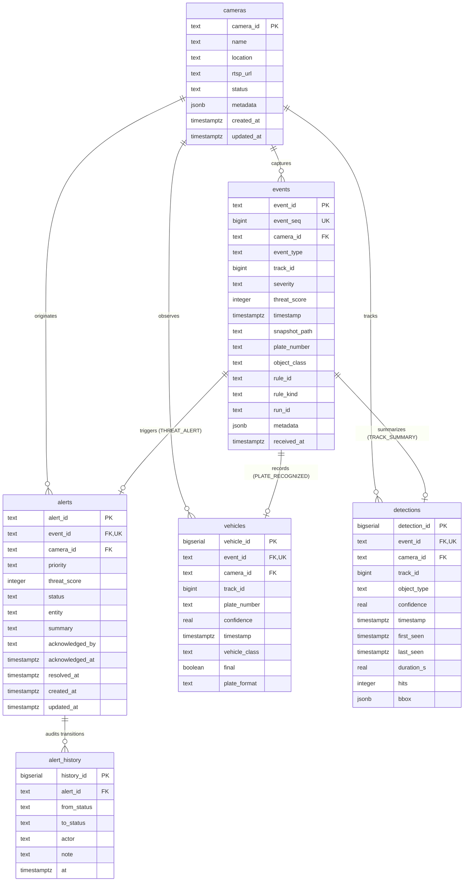
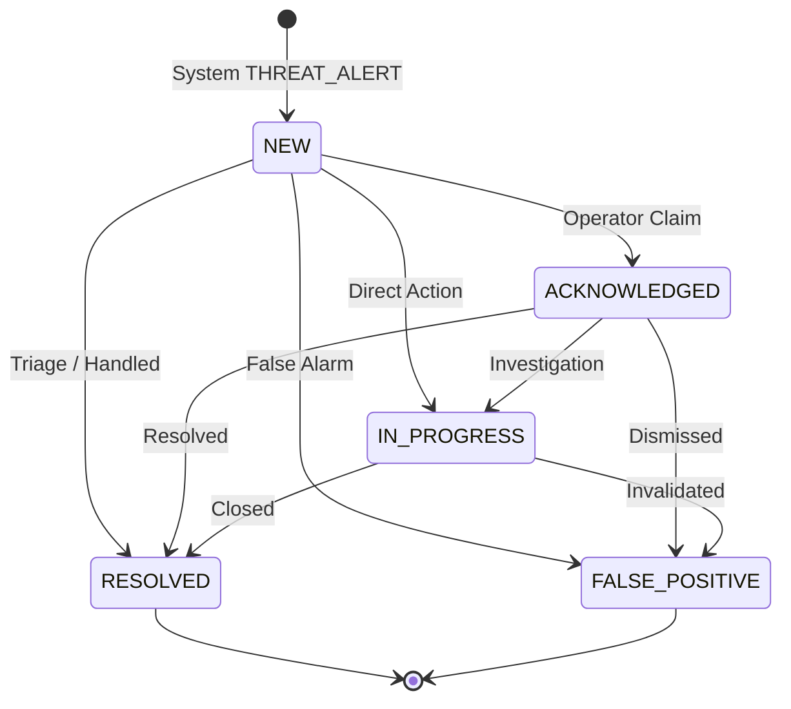

# Core PostgreSQL Database & Persistence Architecture

**Platform Component:** Relational Persistence & State Management Subsystem (`app/db`)  
**Design Reference:** ADR 0013 (`docs/decisions/0013-core-database.md`)  
**Migration:** `database/migrations/003_core_schema.sql`  
**Status:** Production Ready (Day 14)

---

## 1. Architectural Overview & Entity Relationships

The Border-AI relational persistence layer stores all surveillance observations, compound events, actionable alerts, vehicle plate sightings, and track summaries flowing from the Day 13 Redis event bus.



---

## 2. Table-by-Table Schema Reference

### 2.1 `cameras`
Stores edge and perimeter camera metadata. Seeded from `configs/cameras.json`.

| Column | Type | Constraints | Description |
|---|---|---|---|
| `camera_id` | TEXT | PRIMARY KEY, `CHECK (camera_id ~ '^[A-Za-z0-9_.-]{1,64}$')` | Unique camera identifier |
| `name` | TEXT | NOT NULL | Friendly display name |
| `location` | TEXT | NOT NULL, DEFAULT `''` | Sector / physical location |
| `rtsp_url` | TEXT | `CHECK (rtsp_url IS NULL OR rtsp_url !~ '://[^/@]+@')` | Masked RTSP stream address (no credentials) |
| `status` | TEXT | NOT NULL, `CHECK (status IN ('ACTIVE','INACTIVE','OFFLINE','MAINTENANCE','UNREGISTERED'))` | Camera operational state |
| `metadata` | JSONB | NOT NULL, DEFAULT `'{}'` | Source type, frame rate, resolution |
| `created_at` | TIMESTAMPTZ | NOT NULL, DEFAULT `now()` | Registration timestamp |
| `updated_at` | TIMESTAMPTZ | NOT NULL, DEFAULT `now()` | Last modification timestamp |

### 2.2 `events`
Canonical record of all surveillance events emitted by vision pipelines.

| Column | Type | Constraints | Description |
|---|---|---|---|
| `event_id` | TEXT | PRIMARY KEY (1-64 chars) | UUIDv4 idempotency key from event bus |
| `event_seq` | BIGINT | GENERATED ALWAYS AS IDENTITY, UNIQUE | Sequential ID for human reference |
| `camera_id` | TEXT | NOT NULL, REFERENCES `cameras` | Associated camera |
| `event_type` | TEXT | NOT NULL, `CHECK (event_type ~ '^[A-Z][A-Z0-9_]{2,60}$')` | Event category |
| `track_id` | BIGINT | NOT NULL | Associated object track ID |
| `severity` | TEXT | `CHECK (severity IN ('LOW','MEDIUM','HIGH','CRITICAL'))` | Severity tier |
| `threat_score` | INTEGER | `CHECK (threat_score BETWEEN 0 AND 100)` | Threat score (THREAT_ALERT only) |
| `timestamp` | TIMESTAMPTZ | NOT NULL | Physical event occurrence time |
| `snapshot_path` | TEXT | NULLABLE | Relative path to evidence frame |
| `plate_number` | TEXT | NULLABLE | ANPR recognized plate number |
| `object_class` | TEXT | NULLABLE | YOLO detected object class |
| `rule_id` | TEXT | NULLABLE | Rule trigger identifier |
| `rule_kind` | TEXT | NULLABLE | Rule category |
| `run_id` | TEXT | NOT NULL, DEFAULT `''` | Pipeline run directory identifier |
| `metadata` | JSONB | NOT NULL, DEFAULT `'{}'` | Complete lossless event JSON |
| `received_at` | TIMESTAMPTZ | NOT NULL, DEFAULT `now()` | Database ingestion timestamp |

**Readable Reference Function:** `event_ref(seq)` returns formatted strings such as `EVT_000129`.

### 2.3 `alerts`
Actionable security alerts resulting from `THREAT_ALERT` events.

| Column | Type | Constraints | Description |
|---|---|---|---|
| `alert_id` | TEXT | PRIMARY KEY | Unique alert identifier (e.g. `ALR_00001`) |
| `event_id` | TEXT | NOT NULL, UNIQUE, REFERENCES `events` ON DELETE CASCADE | Associated triggering event |
| `camera_id` | TEXT | NOT NULL, REFERENCES `cameras` | Alert camera |
| `priority` | TEXT | NOT NULL, `CHECK (priority IN ('LOW','MEDIUM','HIGH','CRITICAL'))` | Alert priority level |
| `threat_score` | INTEGER | NOT NULL, `CHECK (threat_score BETWEEN 0 AND 100)` | Threat score |
| `status` | TEXT | NOT NULL, DEFAULT `'NEW'`, `CHECK (status IN ('NEW','ACKNOWLEDGED','IN_PROGRESS','RESOLVED','FALSE_POSITIVE'))` | Workflow state |
| `entity` | TEXT | NOT NULL, DEFAULT `''` | Logical entity identifier (e.g. `plate:KA01AB1234`) |
| `summary` | TEXT | NOT NULL, DEFAULT `''` | Explainable alert summary |
| `acknowledged_by` | TEXT | NULLABLE | Operator who acknowledged the alert |
| `acknowledged_at` | TIMESTAMPTZ | NULLABLE | Acknowledgment timestamp |
| `resolved_at` | TIMESTAMPTZ | NULLABLE | Resolution timestamp |
| `created_at` | TIMESTAMPTZ | NOT NULL | Event occurrence time |
| `updated_at` | TIMESTAMPTZ | NOT NULL, DEFAULT `now()` | Last workflow update |

**Integrity Rule:** `CHECK (status = 'NEW' OR acknowledged_by IS NOT NULL)` guarantees that no status change can occur without human operator attribution.

### 2.4 `alert_history`
Append-only audit trail recording every workflow state transition.

| Column | Type | Constraints | Description |
|---|---|---|---|
| `history_id` | BIGSERIAL | PRIMARY KEY | Sequential audit log ID |
| `alert_id` | TEXT | NOT NULL, REFERENCES `alerts` ON DELETE CASCADE | Target alert |
| `from_status` | TEXT | NULLABLE | Previous status (`NULL` for creation) |
| `to_status` | TEXT | NOT NULL | Target status |
| `actor` | TEXT | NOT NULL | Operator username or system daemon |
| `note` | TEXT | NOT NULL, DEFAULT `''` | Operational justification note |
| `at` | TIMESTAMPTZ | NOT NULL, DEFAULT `now()` | Transition audit timestamp |

### 2.5 `vehicles`
Plate sighting records populated from `PLATE_RECOGNIZED` events.

| Column | Type | Constraints | Description |
|---|---|---|---|
| `vehicle_id` | BIGSERIAL | PRIMARY KEY | Sighting ID |
| `event_id` | TEXT | NOT NULL, UNIQUE, REFERENCES `events` ON DELETE CASCADE | Originating event |
| `camera_id` | TEXT | NOT NULL, REFERENCES `cameras` | Sighting camera |
| `track_id` | BIGINT | NOT NULL | Camera track ID |
| `plate_number` | TEXT | NOT NULL | Recognized license plate |
| `confidence` | REAL | NOT NULL, `CHECK (confidence BETWEEN 0 AND 1)` | OCR confidence |
| `timestamp` | TIMESTAMPTZ | NOT NULL | Time plate was recognized |
| `vehicle_class` | TEXT | NULLABLE | Vehicle classification |
| `final` | BOOLEAN | NOT NULL, DEFAULT `FALSE` | Consensus finalized flag |
| `plate_format` | TEXT | NULLABLE | Format validation label |

### 2.6 `detections`
Track summary telemetry populated from `TRACK_SUMMARY` events.

| Column | Type | Constraints | Description |
|---|---|---|---|
| `detection_id` | BIGSERIAL | PRIMARY KEY | Summary ID |
| `event_id` | TEXT | NOT NULL, UNIQUE, REFERENCES `events` ON DELETE CASCADE | Originating event |
| `camera_id` | TEXT | NOT NULL, REFERENCES `cameras` | Camera |
| `track_id` | BIGINT | NOT NULL | Track ID |
| `object_type` | TEXT | NOT NULL | Dominant object class |
| `confidence` | REAL | NOT NULL, `CHECK (confidence BETWEEN 0 AND 1)` | Best detection confidence |
| `timestamp` | TIMESTAMPTZ | NOT NULL | Last seen timestamp |
| `first_seen` | TIMESTAMPTZ | NOT NULL | Initial track birth timestamp |
| `last_seen` | TIMESTAMPTZ | NOT NULL | Track exit timestamp |
| `duration_s` | REAL | NOT NULL, `CHECK (duration_s >= 0)` | Dwell duration in seconds |
| `hits` | INTEGER | NOT NULL, `CHECK (hits >= 0)` | Frame hits count |
| `bbox` | JSONB | NULLABLE | Last observed pixel bbox `[x1, y1, x2, y2]` |

---

## 3. Dashboard Questions to Index Mapping

Every query planned for the Day 15 REST API and Day 17 Dashboard is backed by a specific composite or partial index:

| Dashboard Query Pattern | Target Table | Supporting Index | Index Definition |
|---|---|---|---|
| Latest events (paged, newest first) | `events` | `idx_events_time` | `(timestamp DESC)` |
| Events for a specific camera | `events` | `idx_events_camera_time` | `(camera_id, timestamp DESC)` |
| Filter by event type (`LINE_CROSSING`, etc.) | `events` | `idx_events_type_time` | `(event_type, timestamp DESC)` |
| High-priority events (`CRITICAL`, `HIGH`) | `events` | `idx_events_severity` | `(severity, timestamp DESC) WHERE severity IS NOT NULL` |
| Search events by vehicle plate | `events` | `idx_events_plate` | `(plate_number, timestamp DESC) WHERE plate_number IS NOT NULL` |
| Object track history | `events` | `idx_events_track` | `(camera_id, track_id)` |
| Open alerts list (`NEW`, `ACKNOWLEDGED`) | `alerts` | `idx_alerts_status_time` | `(status, created_at DESC)` |
| Alerts by priority tier | `alerts` | `idx_alerts_priority_time` | `(priority, created_at DESC)` |
| Alerts for a specific camera | `alerts` | `idx_alerts_camera_time` | `(camera_id, created_at DESC)` |
| Escalation history for an entity | `alerts` | `idx_alerts_entity` | `(entity, created_at DESC) WHERE entity <> ''` |
| Alert audit history | `alert_history` | `idx_alert_history_alert` | `(alert_id, history_id)` |
| Vehicle plate sighting history | `vehicles` | `idx_vehicles_plate_time` | `(plate_number, timestamp DESC)` |
| Track summaries per camera | `detections` | `idx_detections_camera_time` | `(camera_id, timestamp DESC)` |

---

## 4. Alert Workflow State Machine

Alerts follow a strict, audited operational lifecycle:



- **Terminal States:** `RESOLVED` and `FALSE_POSITIVE` are final. Accidental status changes must be amended via supervisory database intervention with an audited note.
- **Concurrency Protection:** State transitions execute `SELECT status FROM alerts WHERE alert_id = %s FOR UPDATE`. Concurrent attempts to acknowledge the same alert produce exactly one winner; subsequent operators receive an `InvalidTransition` error.

---

## 5. Operations & Retention Management

### 5.1 Seeding Camera Inventory
```bash
cd ai-engine
python scripts/seed_cameras.py
```

### 5.2 Database Statistics & Counters
```bash
python scripts/db_stats.py
```

### 5.3 Automated Data Retention (`db_retention.py`)
Run policy-driven cleanup preserving alerts longer than high-volume observation events:

```bash
# Dry run report (does not delete)
python scripts/db_retention.py --events-days 30 --alerts-days 365

# Execute deletion
python scripts/db_retention.py --events-days 30 --alerts-days 365 --yes
```

> **Note on Snapshots:** `db_retention.py` purges database rows; evidence snapshot files on disk (`outputs/runs/<RUN>/snapshots/`) are preserved until cleaned by disk maintenance scripts.
