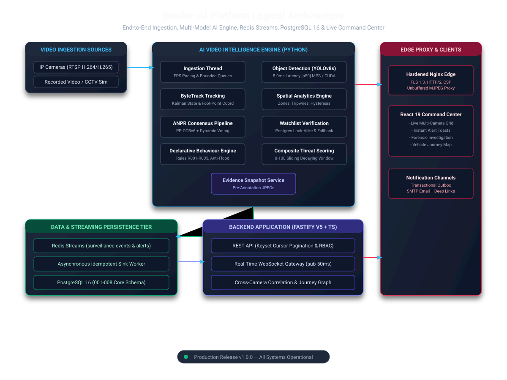

# Border-AI Logical Architecture Specification

This document details the logical architecture, data flow paths, and subsystem interactions of the Border-AI Video Intelligence Platform.

---

## 1. Architectural Diagram

---

## 2. Subsystem Descriptions

### 1. Video Ingestion & Sources
- **IP Cameras / RTSP:** Ingests live H.264/H.265 RTSP streams via thread-per-camera workers with frame dropping buffers and auto-reconnect.
- **Recorded Video:** Replays evaluation benchmark footage at real-time paced framerates.

### 2. AI Video Intelligence Engine (Python 3.11)
- **Object Detection:** Real-time YOLOv8s detecting `person`, `car`, `truck`, `bus`, and `motorcycle` classes with hardware acceleration (Apple Silicon MPS / NVIDIA CUDA).
- **Multi-Object Tracking:** ByteTrack persistent ID association across frames using Kalman filters and foot-point ground contact coordinates (ADR 0005).
- **ANPR Consensus Pipeline:** Plate crop localization, CLAHE contrast enhancement, PaddleOCR PP-OCRv6 character recognition, and multi-frame voting with early stopping (ADR 0023).
- **Spatial Analytics:** Restricted polygonal zones and directional tripwires with temporal hysteresis and debounce.
- **Watchlist Verification:** Real-time PostgreSQL lookup with look-alike character substitution scoring and in-memory fallback snapshot during network partitions.
- **Declarative Behaviour Engine:** Evaluates declarative JSON rules (R001–R005) combining spatial, temporal, classification, and OCR states.
- **Composite Threat Scoring:** Synthesizes observations into a 0–100 threat score and 4-tier alert level (`LOW`, `MEDIUM`, `HIGH`, `CRITICAL`) over an explainable 10-minute sliding window.

### 3. Persistence & Event Streaming
- **Redis Streams:** High-throughput streaming event bus (`surveillance.events` and `surveillance.alerts`) supporting multiple independent consumer groups.
- **Asynchronous Sink:** Idempotent database writer inserting alerts and track lifecycle summaries into PostgreSQL.
- **PostgreSQL 16:** Relational core database storing schema migrations `001` through `008`, users, audit logs, and spatial topologies.

### 4. Backend Application Tier (Node.js 22 + TypeScript)
- **Fastify v5 REST API:** High-performance REST API with Zod type validation, OpenAPI documentation, and $O(1)$ keyset cursor pagination.
- **WebSocket Gateway:** Low-latency event broadcaster pushing sub-50ms alert events directly to operator browsers.
- **Cross-Camera Correlation:** Topological journey reconstruction linking vehicle sightings across camera nodes with travel-time anomaly detection.
- **Transactional Outbox:** Guaranteed, at-least-once email notification dispatcher.

### 5. Edge Proxy & User Interface
- **Hardened Nginx Edge:** Reverse proxy terminating TLS 1.3/HTTP/2, unbuffered MJPEG live streams, and strict security headers.
- **React 19 Command Center:** Operator dashboard featuring live multi-camera grids, real-time alert drawers, forensic investigation filters, and journey graphs.
