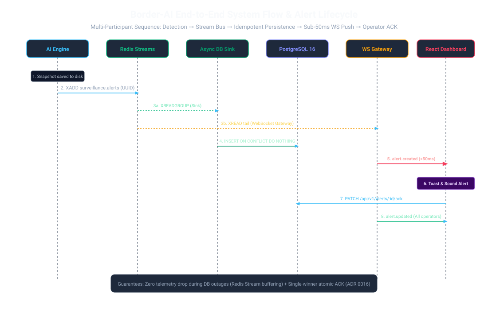

# Border-AI System Flow & Alert Lifecycle Documentation

This document explains the real-time event pipeline sequence, asynchronous database persistence, and threat scoring engine mechanics.

---

## 1. End-to-End System Flow Diagram

### Lifecycle Sequence Steps
1. **Evidence Snapshot Capture:** When an event fires, the Python AI Engine writes a high-resolution pre-annotation JPEG to `/var/lib/border-ai/snapshots/<alert_id>.jpg`.
2. **Streaming Ingestion:** The engine publishes an event envelope to Redis Streams (`surveillance.alerts`) using a deterministic UUID `alert_id`.
3. **Parallel Persistence & Dispatch:**
   - **Database Sink Worker:** Consumes from Redis via consumer group (`surveillance_sink_group`) and performs an idempotent SQL `INSERT ... ON CONFLICT (alert_id) DO NOTHING` into PostgreSQL.
   - **WebSocket Gateway:** Tails the stream via `XREAD` and broadcasts `alert.created` to all active operator sessions in under 50ms.
4. **Operator Triage:** The React dashboard triggers an alert banner, sound chime, and displays the factor breakdown checklist.
5. **Single-Winner Acknowledgement (ADR 0016):** When an operator clicks `Acknowledge`, `PATCH /api/v1/alerts/:id/acknowledge` updates PostgreSQL atomically, broadcasting `alert.updated` across all client sessions to immediately silence sound alerts and mark the item triaged.

---

## 2. Composite Threat Scoring Engine (0–100)

### Mathematical Formulation
The composite threat score $S(t) \in [0, 100]$ for any track at time $t$ is computed as:
$$S(t) = \min\left(100, \sum_{i \in \text{Active Evidence}} P_i \cdot M_i \cdot D(t - t_i)\right)$$

Where:
- $P_i$ represents the rule base points (e.g. Zone Entry = +30, Line Crossing = +20, Night Clock = +10, Watchlist Hit = +40).
- $M_i$ represents the confidence / review multiplier ($M_i = 1.0$ for confirmed, $0.5$ for review status).
- $D(\Delta t) = \max(0, 1 - \frac{\Delta t}{600})$ represents the 10-minute linear decay window.
- Smart exclusion masks (e.g., `excluded_by: ["direction_violation"]`) strictly prevent double-counting of simultaneous spatial triggers.

### Headline Scenarios
- **Scenario 1 (High Alert, Score 60):** Restricted Zone Entry (+30) + Virtual Line Crossing (+20) + After-Hours Movement (+10) = **60 points** ($\to \text{HIGH}$ tier).
- **Scenario 2 (Critical Alert, Score 80):** Stolen Watchlist Vehicle (+40) + Restricted Zone Entry (+30) + After-Hours Movement (+10) = **80 points** ($\to \text{CRITICAL}$ tier, triggers transactional email outbox).
